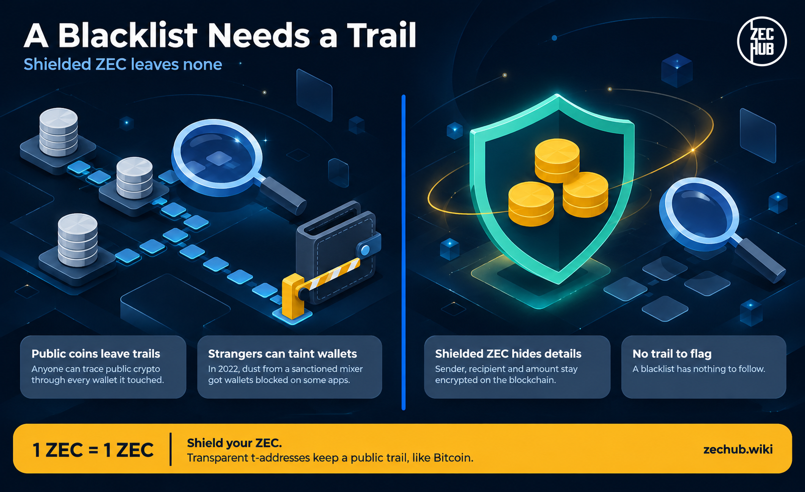

# Fungibility, Explained Simply

## TL;DR

- Money is **fungible** when every unit is worth exactly the same as every other unit.
- A $10 bill is worth $10, whatever happened to it before it reached your pocket.
- On a fully public blockchain, every coin carries its whole history, and a blacklist can follow that trail.
- **Shielded ZEC** keeps that history encrypted. A blacklist has no trail to follow, so one shielded ZEC equals any other.
- Transparent ZEC keeps a public trail like Bitcoin. Fungibility comes from the shielded pool.

---

## Who is this for

- Newcomers who hear "privacy coin" and wonder why privacy matters for everyday money
- Anyone who has run into the phrase "tainted coins"
- Writers and moderators who need a short page to link to

 

## An idea from 1758

In 1758 an English innkeeper named Miller took a banknote from a guest as payment. The note had been stolen from the mail. When Miller brought it to the Bank of England, a clerk named Race refused to pay out.

The case went to Lord Mansfield at the Court of King's Bench, and he ruled for Miller. A person who receives money honestly, in a fair trade, owns it. The original owner cannot take it back from him.

Mansfield's reason was practical. If any banknote could be reclaimed because of something in its past, nobody could safely accept one, and trade would suffer. Money works because you never have to research where it has been. That is fungibility, and it has been part of the law for over 260 years.

 

## A blacklist needs a trail

Bitcoin and Ethereum record every transfer on a public ledger. Anyone can follow a coin back through every wallet it ever touched. Exchanges and analytics companies use this trail to score coins by their past. A coin that once passed near a flagged address can be frozen or turned away, and its current owner may have done nothing wrong.

 

## Strangers can taint your wallet

In August 2022 the U.S. Treasury sanctioned Tornado Cash, an Ethereum mixing tool. The next day an anonymous user sent 0.1 ETH from Tornado Cash to more than 600 public wallets, among them those of Jimmy Fallon, Coinbase CEO Brian Armstrong and Tron founder Justin Sun. Nobody asked for these coins.

The lending app Aave ran wallet screening on its website, and the screening flagged every wallet that had received coins from Tornado Cash. Justin Sun found his address blocked there. Aave fixed the settings within days.

The Treasury removed the Tornado Cash sanctions in March 2025, after a U.S. appeals court found they went beyond its authority. The lesson stayed: on a public ledger, a stranger can attach a history to your money without your permission.

 

## No trail to flag

When you pay from one shielded address to another, the sender, the recipient and the amount are encrypted on the blockchain. The network checks each payment with [zero-knowledge proofs](/zcash-tech/zk-snarks). It confirms that the numbers add up and that no coins appeared from nowhere. Outsiders learn that a valid payment happened. They never see where the coins came from.

A blacklist works by following a coin's past. Shielded ZEC has no public past to follow, so nobody can stamp a coin "clean" or "dirty" by its history. A dusting trick like the 2022 one loses its point, since outsiders cannot see what landed in your wallet. Every shielded ZEC looks the same as every other shielded ZEC. It is Mansfield's 1758 rule, rebuilt with math.

This protects the coins. Rules for people and businesses stay the same, and exchanges keep checking who their customers are.

You also keep the option to show your own history when you want to. A [viewing key](/zcash-tech/viewing-keys) lets an accountant or a tax office read your payments without the power to spend them.

 

## The part beginners miss

Zcash has two kinds of address. Transparent (`t`) addresses work like Bitcoin, so every coin sent to one keeps a public trail. Fungibility lives in the [shielded pool](/using-zcash/shielded-pools).

ZEC bought on an exchange often arrives at a transparent address. Shield it first, and from then on it travels without a visible past.

 

## Put it into practice

1. Pick a wallet from the [wallet list](/using-zcash/wallets) that supports shielded addresses.
2. Receive ZEC to a shielded (`z`) or unified (`u`) address.
3. If ZEC lands on a transparent `t` address, shield it before you spend it.
4. Pay other people at their shielded addresses, so both sides stay private.

 

## Resources

- [Miller v Race (1758) 1 Burr 452, case summary](https://swarb.co.uk/miller-v-race-1758/)
- [CoinDesk: Someone Is Trolling Celebs by Sending ETH From Tornado Cash (Aug 2022)](https://www.coindesk.com/policy/2022/08/09/someone-is-trolling-celebs-by-sending-eth-from-tornado-cash/)
- [The Block: Aave says on-chain wallet address censorship would require DAO consensus (Aug 2022)](https://www.theblock.co/post/163586/aave-says-on-chain-wallet-address-censorship-will-require-dao-consensus)
- [U.S. Treasury: Tornado Cash Delisting (Mar 2025)](https://content.govdelivery.com/accounts/USTREAS/bulletins/3d80cdc)

 

## Related pages

- [Who can see your Zcash payment?](/start-here/who-can-see-your-zcash-payment)
- [Shielded pools](/using-zcash/shielded-pools)
- [Viewing keys](/zcash-tech/viewing-keys)
- [zk-SNARKs](/zcash-tech/zk-snarks)
- [Wallets](/using-zcash/wallets)
