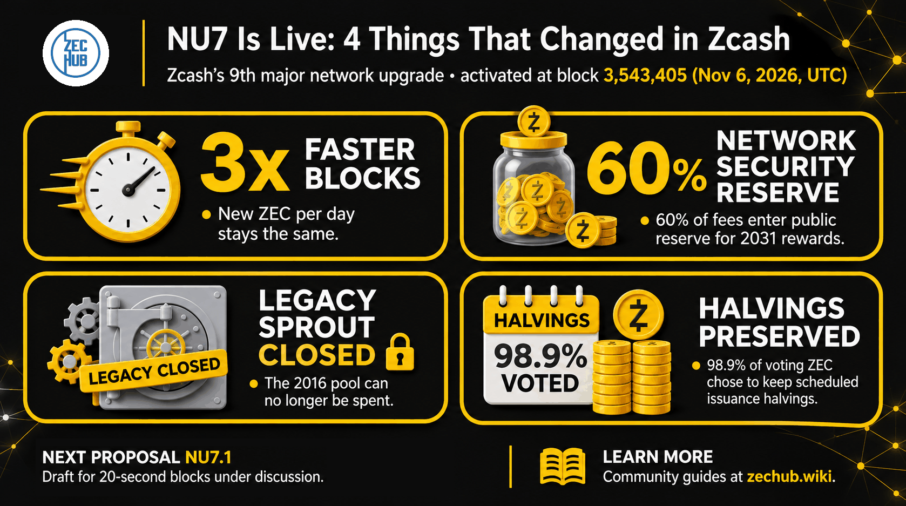

# NU7

> تم تفعيل NU7 على الشبكة الرئيسية لـ Zcash عند الكتلة 3,543,405 في 6 نوفمبر 2026 (02:34 UTC؛ مساء 5 نوفمبر في المناطق الزمنية الأمريكية)، وما زال مفعّلًا منذ ذلك الحين.

ما ستخرج به: ما الذي غيّرته NU7 (كتل أسرع، وحدود للإجراءات المحمية، وإعادة تدوير الرسوم، وإنهاء المعاملات من الإصدار 4)، وما الذي أبقته كما هو، وما الذي كان على مشغّلي العقد والمحافظ ومنصات التداول والمعدّنين فعله.

NU7 هي ترقية شبكة Zcash [network upgrade](../start-here/network-upgrades)، نُشرت بموجب [ZIP 259](https://zips.z.cash/zip-0259). خفّضت الوقت بين الكتل من 75 ثانية إلى 25 ثانية، وحدّت عدد الإجراءات المحمية التي تتسع لها الكتلة الواحدة، وبدأت بإخراج 60% من رسوم المعاملات من التداول لإعادة إصدارها للمعدّنين مستقبلًا، وجعلت معاملات الإصدار 4 غير صالحة، ما أدى إلى إنهاء المجمّع القديم Sprout. لم تُقدّم تنسيقًا جديدًا للمعاملات. معرّف فرع الإجماع الخاص بها هو `0x77190ad9`.

لماذا يهم ذلك. قبل NU7، كنت تنتظر 75 ثانية في المتوسط للحصول على التأكيد الأول، وهذا بطيء عند صندوق متجر أو لإيداع في منصة تداول أو لمبادلة عبر السلاسل. خفّضت NU7 ذلك إلى نحو 25 ثانية دون إصدار مزيد من ZEC: فقد خُفّضت المكافأة لكل كتلة إلى الثلث، لذلك ظل الإصدار اليومي كما هو. وهي أيضًا أول ترقية تضيف آلية تهدف إلى تمويل أمن الشبكة بعد تقلص مكافآت الكتل.

هل أنت جديد على Zcash؟ ابدأ بـ [ما هي ZEC وZcash](../start-here/what-is-zec-and-zcash) و[المجمّعات المحمية](../using-zcash/shielded-pools)، ثم عُد إلى هنا.

## خلاصة سريعة

بكلمات بسيطة: تصل الكتل الآن كل 25 ثانية، وتبقى كمية ZEC الجديدة يوميًا كما هي، ويُدّخر جزء من كل رسوم لإعادة إصداره للمعدّنين مستقبلًا، ويُغلق المجمّع القديم Sprout.

- **كتل كل 25 ثانية** ([ZIP 218](https://zips.z.cash/zip-0218)): يستغرق التأكيد الأول نحو 25 ثانية بدلًا من 75. انخفضت إعانة الكتلة من 1.5625 إلى 0.52083333 ZEC، لذلك لا يزال يُصدر نحو 1,800 ZEC يوميًا.
- **حدود الإجراءات المحمية** (ZIP 218): بحد أقصى 330 إجراءً محميًا لكل كتلة عبر جميع المجمّعات، مع حدود لكل مجمّع، لإبقاء تكاليف التحقق من الكتلة ومزامنة المحفظة في أسوأ الحالات دون مستواها السابق.
- **آلية استدامة الشبكة** ([ZIP 235](https://zips.z.cash/zip-0235) + [ZIP 237](https://zips.z.cash/zip-0237)): تخرج 60% من رسوم المعاملات في كل كتلة من التداول، ثم يُعاد إصدارها للمعدّنين لاحقًا، بدءًا من الكتلة 8,939,664 (المتوقع في فبراير 2031 تقريبًا). لم يتغير الحد الأقصى للمعروض البالغ 21 مليونًا.
- **معاملات الإصدار 4 غير صالحة** ([ZIP 2003](https://zips.z.cash/zip-2003)): يجب أن تنشئ المحافظ معاملات v5 أو v6. لا يمكن إنفاق Sprout إلا باستخدام v4، لذا أصبحت الأموال التي لا تزال في Sprout مجمّدة الآن.
- **البرمجيات**: تتبع [Zebra 7.0.0](https://github.com/ZcashFoundation/zebra/releases/tag/v7.0.0) والإصدارات الأحدث NU7. لا يوجد إصدار `zcashd` يدعم NU7.

## تشبيه بصري

تخيّل السلسلة كخط قطارات. قبل NU7، كان القطار ينطلق كل 75 ثانية ويمكنه نقل عدد الركاب الذين تتسع لهم مساحة 2 MB. أما NU7 فتُسيّر قطارًا كل 25 ثانية، وتدفع لكل سائق ثلث الأجرة القديمة كي يبقى الإجمالي اليومي كما هو، وتضع حدًا لعدد أثقل الركاب (الإجراءات المحمية) الذين يمكنهم ركوب قطار واحد، حتى لا يستغرق التحقق من أي قطار وقتًا طويلًا جدًا.

## ما الذي غيّرته NU7

### استهداف تباعد قدره 25 ثانية بين الكتل (ZIP 218)

- يستهدف ضبط الصعوبة الآن كتلة واحدة كل **25 ثانية** بدلًا من 75، لذا تصل الكتل بمعدل يزيد ثلاثة أضعاف.
- قُسمت إعانة الكتلة على ثلاثة: **0.52083333 ZEC** لكل كتلة في فترة التنصيف الحالية (وكانت 1.5625 ZEC). يظل الإصدار اليومي نحو 1,800 ZEC (3,456 كتلة يوميًا بدلًا من 1,152).
- لا يزال التنصيف يحدث كل أربع سنوات. وبسبب سرعة الكتل، انتقل موعد التنصيف التالي إلى الكتلة **6,132,390**، والمتوقع في أواخر نوفمبر 2028 تقريبًا عند تباعد قدره 25 ثانية (ZIP 259).
- زادت نافذة متوسط الصعوبة من 17 إلى **102 كتلة**، لتظل عملية الضبط تنظر إلى فترة زمنية مماثلة.
- زاد انتهاء صلاحية المعاملة الافتراضي من 40 إلى **120 كتلة**، ليبقى عند نحو 50 دقيقة.

### حدود الإجراءات المحمية (ZIP 218)

لكل كتلة الآن ميزانية مشتركة وحدود لكل مجمّع:

| الحد | لكل كتلة |
|---|---|
| جميع الإجراءات المحمية عبر المجمّعات | 330 |
| إجراءات Orchard | 330 |
| إجراءات Ironwood | 330 |
| مدخلات Sapling + مخرجاتها | 300 |
| Sprout JoinSplits | غير مسموح |

قبل NU7، كان يمكن لكتلة كاملة بحجم 2 MB أن تضم نحو 617 إجراءً من Orchard أو Ironwood، أو نحو 2,107 مخرجات من Sapling، دون حدود لكل مجمّع. تحدد ZIP 218 الحدود الجديدة بحيث تصبح أسوأ الحالات للعقد ولمزامنة المحافظ أقل مما كانت عليه سابقًا، حتى مع زيادة عدد الكتل ثلاثة أضعاف (مثلًا، ينخفض عرض النطاق الترددي لمزامنة العميل الخفيف المحمية من نحو 271 إلى 169 MB يوميًا)، في حين يزيد معدل النقل لبروتوكول Orchard إلى أكثر من الضعف (من نحو 2.9 إلى 6.6 معاملات في الثانية للمعاملات ذات الإجراءين).

### آلية استدامة الشبكة (ZIP 235 + ZIP 237)

- **إخراج الرسوم (ZIP 235):** يُخرج 60% من رسوم المعاملات في كل كتلة من التداول؛ أما الـ40% المتبقية فتذهب إلى المعدّن كما في السابق. وعلى خلاف الحرق، تُتتبّع ZEC المُزالة كي يمكن إصدارها مجددًا لاحقًا.
- **إعادة الإصدار (ZIP 237):** تُحفظ ZEC المُزالة في حالة إجماع عامة تُسمى رصيد قيمة NSM. وقد أُضيف إلى رصيدها الأولي عند NU7 ما تركه المعدّنون من مكافآت غير مطالب بها في الماضي. وابتداءً من الكتلة **8,939,664** (المتوقع في فبراير 2031 تقريبًا)، تصدر كل كتلة جزءًا ثابتًا من ذلك الرصيد، إضافة إلى جدول التنصيف المعتاد.
- لا يرتفع الحد الأقصى للمعروض. عندما يصبح الرصيد صفرًا، يتطابق الإصدار تمامًا مع جدول التنصيف القديم.
- لم تنشر NU7 [ZIP 233](https://zips.z.cash/zip-0233) (الإزالة الطوعية من قِبل المستخدمين) أو [ZIP 234](https://zips.z.cash/zip-0234) (استبدال التنصيف بمنحنى سلس). اختارت استطلاعات حاملي العملات التصميم الذي يحافظ على التنصيف في ZIP 237.
- تجد الأرقام (رصيد البداية البالغ 368.58 ZEC، ونسبة إعادة الإصدار لكل كتلة، وسبب البدء عند الكتلة 8,939,664) في صفحة [آلية استدامة الشبكة](./Network_Sustainability_Mechanism.md).

### منع معاملات الإصدار 4 (ZIP 2003)

- ابتداءً من NU7، تصبح كل معاملة من الإصدار 4 غير صالحة: ليس فقط تحويلات Sprout، بل أيضًا المعاملات الشفافة فقط ومعاملات Sapling المنشأة بتنسيق v4. لا تتغير معاملات الإصدار 5 (NU5) والإصدار 6 ([Ironwood](../zcash-tech/ironwood)).
- لا توجد تحويلات Sprout إلا بتنسيق v4، لذا لم يعد بالإمكان الإنفاق من المجمّع [Sprout](../zcash-tech/sprout). راجع [استعادة الأموال](../using-zcash/recovering-funds).

### تغييرات أصغر

- مراجعات لقواعد صندوق التطوير كي تتوافق قنوات التمويل مع كتل مدتها 25 ثانية (المراجعة 2 في [ZIP 207](https://zips.z.cash/zip-0207)، والمراجعة 3 في [ZIP 214](https://zips.z.cash/zip-0214))، وتحديث لقائمة عناوين قنوات التمويل ([ZIP 2008](https://zips.z.cash/zip-2008)).
- تعلن عقد NU7 عن إصدار بروتوكول الشبكة **170190** على Mainnet، وتفصل الأقران الأقدم بعد التفعيل.

## ما الذي لم تفعله NU7

- **لم تُقدّم تنسيقًا جديدًا للمعاملات.** تجنبت NU7 عمدًا إجراء ترحيل آخر للمحافظ والمحللات بعد وقت قصير من تقديم Ironwood معاملات v6.
- **لم تغيّر الحد الأقصى للمعروض أو إيقاع التنصيف كل أربع سنوات.**
- **لم تغيّر نضج مكافأة التعدين.** تظل العملات المستخرجة بحاجة إلى 100 كتلة قبل إنفاقها (أي نحو 42 دقيقة الآن بدلًا من ساعتين تقريبًا).
- **لم تُضف مجمّعًا محميًا جديدًا.** لا يزال Ironwood (NU6.3) أحدث مجمّع؛ ويظل Orchard متاحًا للإنفاق فقط، كما هو منذ Ironwood.

## ما الذي كان على كل فئة فعله

- **مشغّلو العقد:** شغّل [Zebra 7.0.0](https://github.com/ZcashFoundation/zebra/releases/tag/v7.0.0) أو إصدارًا أحدث. ينقل Zebra 7 قاعدة بياناته من التنسيق v28 إلى v29 عند بدء التشغيل لأول مرة، ولا يستطيع Zebra 6.x قراءة v29، لذا أنشئ نسخة احتياطية من `state/v28` قبل الترقية. لا يتوفر إصدار `zcashd` NU7 (أحدث إصدار له هو 6.20.0، الصادر في يونيو 2026)؛ ويوضح دليل ترحيل API الخاص بـ Zebra[zcashd في الكتاب ](https://zebra.zfnd.org/user/zcashd-api-migration-guide.html) كيفية تحويل كل استدعاء RPC في `zcashd` إلى Zebra أو [Zallet](../zcash-tech/zallet) أو بديله. راجع [العقد الكاملة](../zcash-tech/full-nodes) ودليل [المقوّى Zebra](../guides/hardened-zebrad).
- **المحافظ:** توقّف عن إنشاء معاملات v4، واستخدم مدة الصلاحية الافتراضية البالغة 120 كتلة، وحافظ على عمق الارتكاز البالغ 3 كتل (أي نحو 1.25 دقيقة الآن)، والتزم بحدود الإجراءات لكل كتلة. لا يمكن تعدين معاملة تتجاوز بمفردها أحد هذه الحدود.
- **منصات التداول وخدمات الدفع:** يستغرق التأكيد الآن 25 ثانية، لذا يغطي العدد نفسه من التأكيدات ثلث المدة السابقة. أعد التحقق من عدد التأكيدات المطلوبة للإيداع وفقًا للوقت والأمان اللذين تريدهما فعلًا، بدلًا من الإبقاء على العدد القديم بدافع العادة.
- **المُعدّنون والمجمّعات:** يجب أن تستخدم برمجيات التعدين والقوالب الدعم الجديد وتقسيم الرسوم وحدود الإجراءات؛ إذ تُرفض الكتل المبنية على القواعد القديمة.

## أخطاء شائعة

- **«العقدة القديمة ما زالت تعمل، إذًا كل شيء على ما يرام».** في حالة NU7 وحدها، أعفت ZIP 259 البرمجيات السابقة للترقية من القاعدة المعتادة التي تفرض عليها الإغلاق قبل التفعيل. يمكن لعقدة Zebra 6.x أو عقدة `zcashd` أن تبقى متصلة على القواعد القديمة، ثم تخرج بصمت عن السلسلة الحقيقية. تحقق من أن ارتفاع العقدة يتجاوز 3,543,405 وأنها تطابق مستكشف الكتل.
- **«الكتل الأسرع تعني إصدار مزيد من ZEC».** لا. انخفضت إعانة الكتلة إلى الثلث، لذلك لم يتغير الإصدار اليومي.
- **«تُحرق 60% من الرسوم إلى الأبد».** لا. تُزال الرسوم ثم تعيد آلية NSM إصدارها للمعدّنين؛ ولم يتغير الحد الأقصى للمعروض.
- **«لا يتأثر بتغيير v4 إلا مستخدمو Sprout».** توقفت عن العمل أي محفظة أو نص برمجي ما زال ينشئ معاملات v4، بما فيها معاملات الشفافية فقط ومعاملات Sapling. أصبحت معاملات v4 المعلّقة غير صالحة عند التفعيل، ولا يكفي توقيعها من جديد لجعلها صالحة.
- **«تظل الإعدادات المقاسة بعدد الكتل كما هي».** كل ما يُقاس بالكتل (التأكيدات وانتهاء الصلاحية وأوقات القفل والمهل) يمر الآن أسرع بثلاثة أضعاف في الزمن الفعلي.

## مسرد المصطلحات

| المصطلح | المعنى المبسط |
|---|---|
| Block target spacing | متوسط الوقت بين الكتل الذي يستهدفه ضبط الصعوبة: 25 ثانية منذ NU7 |
| Block subsidy | ZEC الجديد الذي يُنشأ في كل كتلة، ويُوزع بين المعدّن وقنوات صندوق التطوير |
| Shielded action | وحدة واحدة من العمل المحمي في معاملة (إجراء Orchard أو Ironwood، أو مدخل أو مخرج من Sapling) |
| Network Sustainability Mechanism (NSM) | القواعد التي تخرج جزءًا من الرسوم من التداول وتعيد إصدارها للمعدّنين مستقبلًا |
| NSM Value Balance | الإجمالي التراكمي العام لـ ZEC المُزالة من التداول والمنتظرة إعادة إصدارها |
| Version 4 transaction | تنسيق المعاملات من Sapling، الذي جعلته NU7 غير صالح؛ ويظل الإصداران v5 وv6 صالحين |
| Consensus branch ID | رقم يحدد مجموعة من قواعد الإجماع؛ وتلتزم التواقيع الرقمية به، لذا تكون المعاملة الموقعة وفق القواعد القديمة غير صالحة بموجب القواعد الجديدة |

## الأسئلة الشائعة

**متى فُعّلت NU7؟** عند الكتلة 3,543,405 على Mainnet في 6 نوفمبر 2026، الساعة 02:34 UTC. وفُعّلت على Testnet قبل ذلك، عند الكتلة 4,465,026 في 4 أكتوبر 2026.

**هل تغيرت مكافأة الكتلة؟** لكل كتلة، نعم: 0.52083333 ZEC بدلًا من 1.5625 ZEC. أما يوميًا، فلا: نحو 1,800 ZEC في الحالتين.

**هل اختفت Sprout ZEC الخاصة بي؟** لم يعد بالإمكان نقلها، لأن إنفاق Sprout يتطلب معاملات v4، وهي غير صالحة الآن. راجع [استعادة الأموال](../using-zcash/recovering-funds) لمعرفة ما يعنيه ذلك عمليًا.

**هل أحتاج إلى محفظة جديدة؟** تحتاج إلى إصدار من المحفظة يدعم NU7. تعرض صفحة ZecHub لـ [Wallets](../using-zcash/wallets) المحافظ المتوافقة مع NU7.

**متى تبدأ إعادة إصدار الرسوم؟** عند الكتلة 8,939,664 على Mainnet، والمتوقع في فبراير 2031 تقريبًا إذا ظل متوسط زمن الكتلة 25 ثانية.

**لماذا تخطت NU7 تقديم تنسيق جديد للمعاملات؟** لتجنيب المحافظ والمحللات ترحيلًا ثانيًا بعد وقت قصير من تنسيق v6 الخاص بـ Ironwood، ولأن تقسيم الرسوم يُحسب لكل كتلة، لذلك لم تكن هناك حاجة إلى حقل جديد في المعاملة.

## اختبر فهمك

1. لماذا يظل إصدار ZEC اليومي كما هو بعد NU7؟
2. ماذا يحدث لـ60% من الرسوم التي تُخرج من التداول؟
3. لماذا لا يمكن إنفاق أموال Sprout بعد NU7؟
4. لماذا تُعد العقدة التي لم تُحدّث قط خطرة على نحو خاص في هذه الترقية؟

الإجابات: (1) خُفّضت إعانة الكتلة إلى الثلث، بينما أصبحت الكتل أكثر تكرارًا بثلاثة أضعاف؛ (2) تُضاف إلى رصيد قيمة NSM ويُعاد إصدارها للمعدّنين ابتداءً من الكتلة 8,939,664؛ (3) لا توجد معاملات إنفاق Sprout إلا بتنسيق v4، الذي جعلته NU7 غير صالح؛ (4) أعفت ZIP 259 العقد من الإغلاق التلقائي، لذا يمكن للعقدة القديمة أن تواصل العمل على سلسلة خاطئة.

### المصادر

[ZIP 259: نشر ترقية شبكة NU7](https://zips.z.cash/zip-0259)

[ZIP 218: استهداف تباعد قدره 25 ثانية بين الكتل](https://zips.z.cash/zip-0218)

[ZIP 235: إخراج 60% من رسوم المعاملات من التداول](https://zips.z.cash/zip-0235)

[ZIP 237: آلية استدامة الشبكة: إصدار يحافظ على التنصيف](https://zips.z.cash/zip-0237)

[ZIP 2003: منع معاملات الإصدار 4](https://zips.z.cash/zip-2003)

[Zebra ملاحظات الإصدار 7.0.0](https://github.com/ZcashFoundation/zebra/releases/tag/v7.0.0)

[Zcash منتدى المجتمع: NU7 الجدول الزمني](https://forum.zcashcommunity.com/t/nu7-timeline/57655)

## صفحات ذات صلة

| الصفحة | سبب الصلة |
|---|---|
| [Ironwood](./Ironwood.md) | الترقية السابقة في السلسلة، التي قدّمت معاملات v6 |
| [ما الذي تغيّره الكتل ذات الـ25 ثانية فعلًا](../research/what-25-second-blocks-actually-change) | نظرة أعمق إلى تسريع زمن الكتلة |
| [آلية استدامة الشبكة](./Network_Sustainability_Mechanism.md) | كيفية عمل آليتي إخراج الرسوم وإعادة إصدارها NU7 بعد تفعليهما، مع الأرقام |
| [Sprout](./Sprout.md) | المجمّع الذي NU7 أُنهي |
| [استعادة الأموال](../using-zcash/recovering-funds) | معنى تجميد Sprout الأموال القديمة |
| [المعاملات](../using-zcash/transactions) | انتهاء الصلاحية والتأكيدات بعد NU7 |

---

السلسلة: فهرس [ترقيات الشبكة](../start-here/network-upgrades) · السابق: [Ironwood](../zcash-tech/ironwood)
