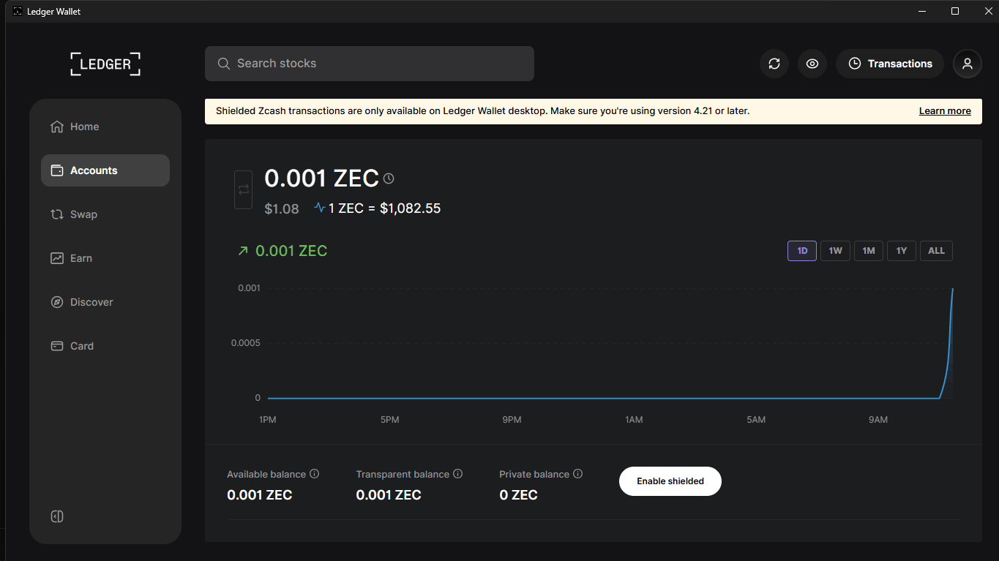
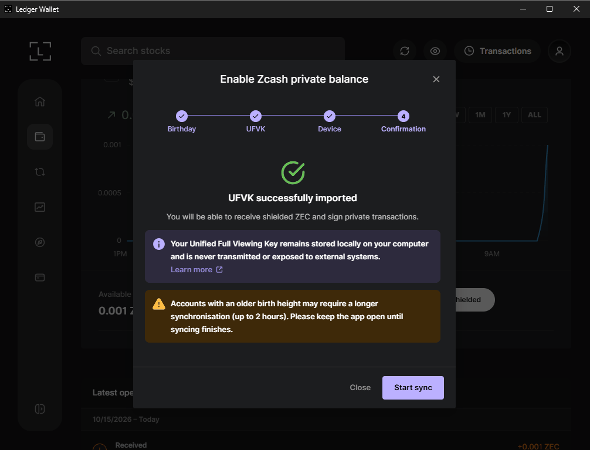
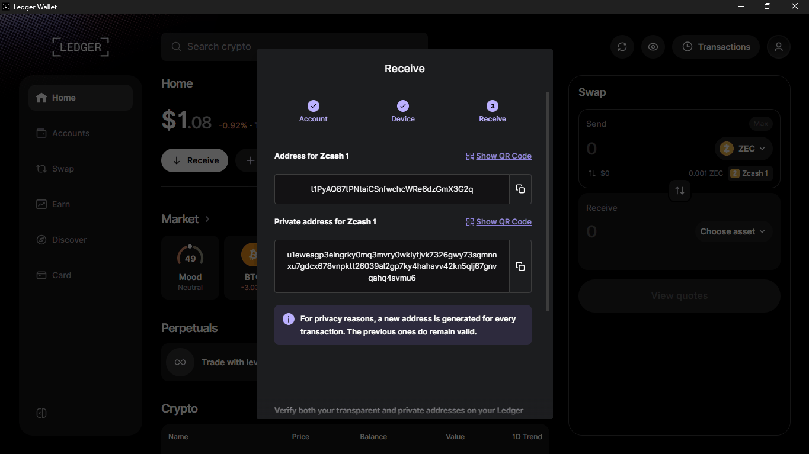
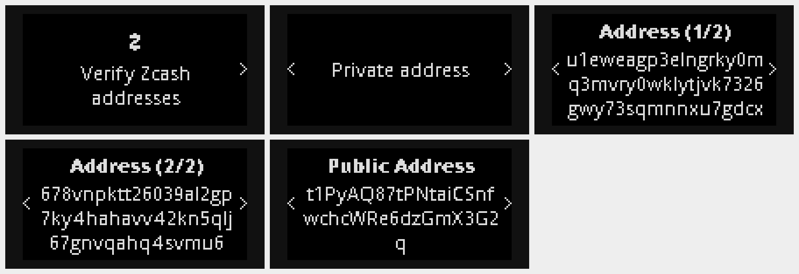
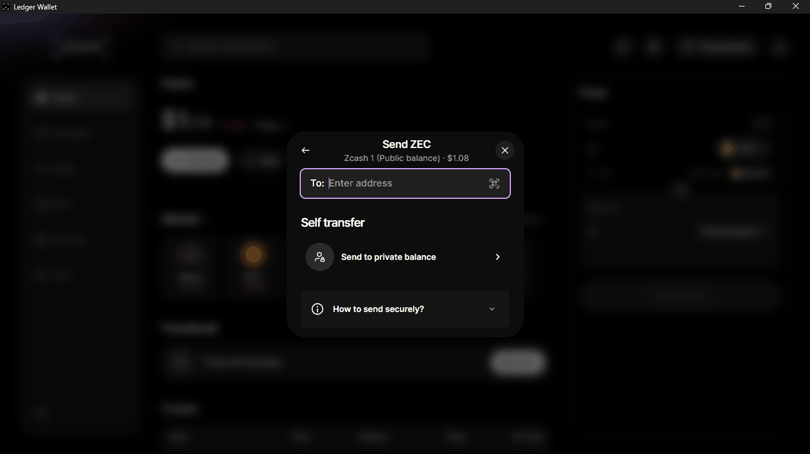
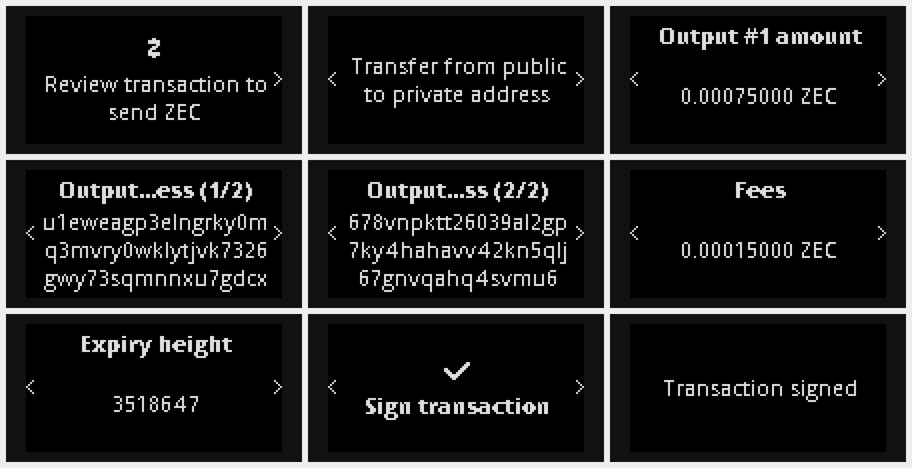
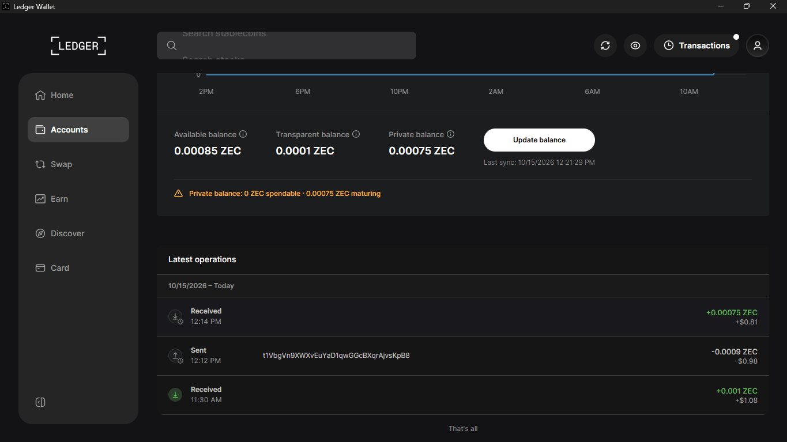
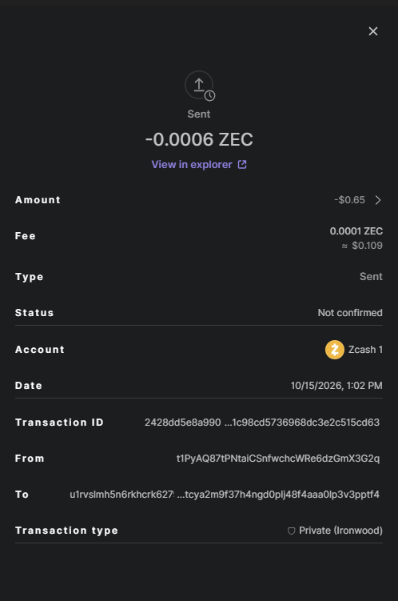

# Guida utente Ledger per gli ZEC schermati

> Conserva, ricevi e invia ZEC privati (schermati) con il tuo portafoglio hardware Ledger in Ledger Wallet Desktop.

## TL;DR

* Dal 23 settembre 2026, Ledger Wallet Desktop supporta gli ZEC schermati. Un account Zcash ha un saldo trasparente e un saldo privato nella pool Ironwood.
* Per ora solo desktop. Il supporto mobile è annunciato come "in arrivo".
* Ti servono un Nano S Plus, un Nano X, uno Stax o un Flex (non il Nano S originale), Ledger Wallet Desktop 4.21+ e l'ultima versione dell'app Zcash.
* Clicca una volta sola su **Enable shielded**: il tuo Ledger esporta le chiavi di visualizzazione così l'app desktop può trovare i tuoi fondi privati. Le chiavi di spesa non lasciano mai il dispositivo.
* Ricevi sull'indirizzo privato (u1...) quando puoi. Spostare ZEC dal saldo trasparente al privato funziona, ma collega i due.
* Ogni invio viene controllato e firmato sulla schermata del Ledger. Verifica lì gli indirizzi, carattere per carattere.

## Spiegazione di base

Zcash ha due tipi di saldo. Il ZEC trasparente (indirizzi t1) funziona come Bitcoin: importi e indirizzi sono pubblici. Lo ZEC schermato si trova in una pool schermata, dove mittente, destinatario e importo sono crittografati on-chain.

Ledger mantiene le tue chiavi di spesa sul dispositivo hardware. Per mostrare un saldo privato, Ledger Wallet Desktop ha bisogno di una Unified Full Viewing Key (UFVK). Il dispositivo la esporta una sola volta, e l'app desktop la usa per scansionare la blockchain alla ricerca delle tue note schermate. Una chiave di visualizzazione può vedere la tua cronologia schermata ma non può spendere, quindi trattala come un'informazione privata.

I passaggi seguenti coprono l'installazione dell'app Zcash, l'aggiunta di un account, l'attivazione del saldo privato, la ricezione, la schermatura di ZEC trasparente e l'invio dal saldo privato.

## Panoramica

Il 23 settembre 2026 Ledger ha aggiunto il supporto nativo per gli ZEC schermati in Ledger Wallet Desktop. Un account Zcash ora contiene un saldo trasparente e un saldo privato nella pool Ironwood di Zcash. Le tue chiavi private restano sul tuo Ledger, e ogni transazione viene controllata e firmata sul dispositivo.

**Solo desktop.** L'annuncio di Ledger dice che lo ZEC schermato è "disponibile solo su Ledger Wallet Desktop. Il supporto mobile non è disponibile al momento, ma arriverà a breve". L'app desktop mostra lo stesso avviso. Verificato il 15 ottobre 2026.

## Preparazione

- Un dispositivo Ledger che esegue l'app Zcash: Nano S Plus, Nano X, Stax o Flex. L'app Zcash attuale non è progettata per il Nano S originale.
- Ledger Wallet Desktop 4.21 o successivo, da scaricare solo da [ledger.com](https://www.ledger.com). Questa guida ha usato la versione 4.24.0.
- L'ultima versione dell'app Zcash sul tuo Ledger (3.9.4 quando questa guida è stata scritta).
- Una piccola quantità di ZEC per fare le prove. Ogni passaggio qui sotto è stato eseguito sulla mainnet con 0,001 ZEC. Ogni transazione costa una piccola commissione di rete (0,00015 ZEC nel nostro test).
- La tua frase di recupero di 24 parole resta su carta. Non digitarla mai su un computer e non condividerla.

## Guida passo per passo (Ledger Wallet Desktop)

**1. Installa o aggiorna l'app Zcash**
- Apri Ledger Wallet, collega e sblocca il tuo Ledger e apri **My Ledger**. Consenti la connessione sul dispositivo.
- Cerca **Zcash** nel catalogo delle app, poi clicca su **Install**, oppure su **Update** se è già installata.
- Apri l'app Zcash sul tuo Ledger. La schermata mostra "Zcash app is ready". Scorri a destra fino a **App info** per controllare la versione.

**2. Aggiungi un account Zcash**
- In Ledger Wallet, scegli **Add account**. In **Select asset**, cerca Zcash e seleziona **Zcash (ZEC)**, non un token wrapped come Binance-Peg Zcash Token.
- Con l'app Zcash aperta sul tuo Ledger, Ledger Wallet trova il tuo account. Spuntalo sotto **Select the accounts you want to add** e clicca su **Confirm**.
- La pagina dell'account mostra **Available balance**, **Transparent balance** e **Private balance**, più un pulsante **Enable shielded**.

**3. Attiva il saldo privato**
- Clicca su **Enable shielded**. La finestra **Enable Zcash private balance** ha quattro passaggi: Birthday, UFVK, Device e Confirmation.
- **Birthday:** per un account nuovo, lascia l'altezza di compleanno sulla data di oggi. Spunta "This account received shielded ZEC in the past" solo se sai che è successo, perché la scansione dal blocco 0 può richiedere molto tempo.
- **UFVK e Device:** Ledger Wallet chiede al tuo Ledger di esportare la tua Unified Full Viewing Key (UFVK). Leggi le schermate sul dispositivo e approva. Se vedi "Device connection lost", assicurati che l'app Zcash sia aperta, approva prontamente e clicca su **Retry**.
- Quando vedi **UFVK successfully imported**, clicca su **Start sync**. Quando la sincronizzazione finisce, il pulsante diventa **Update balance** con l'ora "Last sync".
- La chiave di visualizzazione resta sul tuo computer. Può trovare i tuoi fondi schermati ma non può spenderli.

**4. Ricevi ZEC e verifica entrambi gli indirizzi sul tuo Ledger**
- Clicca su **Receive** e scegli il tuo account Zcash. Ledger Wallet mostra un **Address for Zcash 1** (trasparente, inizia con t1) e un **Private address for Zcash 1** (inizia con u1). Gli indirizzi precedenti restano validi.
- Il tuo Ledger mostra "Verify Zcash addresses", il **Private address** su due pagine, poi il **Public Address**. Confronta ogni carattere con la schermata prima di condividere uno dei due indirizzi, poi conferma sul dispositivo.
- Preferisci l'indirizzo privato; usa quello trasparente solo quando il mittente non supporta nient'altro.

**5. Sposta gli ZEC trasparenti nel tuo saldo privato**
- Clicca su **Send**. Sotto **Self transfer**, scegli **Send to private balance**.
- Inserisci un importo oppure usa 25%, 50%, 75% o **Max**. Controlla la commissione di rete, poi clicca su **Review**.
- Sul tuo Ledger, scorri le schermate: "Review transaction to send ZEC", "Transfer from public to private address", l'importo, l'indirizzo di destinazione su due pagine, la commissione e l'altezza di scadenza. Verifica che l'indirizzo di destinazione corrisponda al tuo indirizzo privato del passaggio 4, poi premi entrambi i pulsanti su **Sign transaction**.
- Ledger Wallet mostra **Transaction sent**. Nei dettagli della transazione, il tipo è **Private (Ironwood)**.
- Ledger Wallet fa notare che un self transfer collega i tuoi fondi schermati al tuo indirizzo pubblico. Ricevere direttamente sul tuo indirizzo privato li mantiene scollegati.

- Dopo la conferma della transazione, il saldo trasparente scende e quello privato sale. I nuovi fondi schermati appaiono come "maturing" finché non hanno abbastanza conferme per poter essere spesi.

**6. Invia ZEC dal tuo saldo privato**
- Quando il saldo privato è spendibile, clicca su **Send** e imposta **Transfer from** su **Private balance**.
- Incolla l'indirizzo del destinatario e inserisci l'importo. Puoi aggiungere un **Memo (optional)** crittografato fino a 512 byte, che solo il destinatario può leggere.
- Controlla destinatario, importo e commissione sul tuo Ledger, poi premi entrambi i pulsanti su **Sign transaction**.

## Buono a sapersi

- Lo ZEC schermato su Ledger per ora funziona solo su desktop (verificato il 15 ottobre 2026).
- Il saldo privato di Ledger Wallet usa la pool Ironwood.
- Ledger dice che puoi condividere con un consulente fiscale l'accesso in sola lettura alla cronologia delle tue transazioni. Chiunque abbia la tua chiave di visualizzazione può vedere la tua cronologia schermata, quindi condividila solo di proposito.
- Le schermate del dispositivo in questa guida sono state catturate con l'emulatore Speculos di Ledger (Nano S Plus) che esegue l'app Zcash 3.9.4, collegato a Ledger Wallet Desktop 4.24.0 sulla mainnet di Zcash. Un Ledger fisico esegue la stessa app e mostra le stesse schermate.

## Aiuto extra

- [Novità in Ledger Wallet: supporto nativo per Zcash schermato](https://www.ledger.com/blog-native-shielded-zcash-support) (annuncio di Ledger)
- [Help Center di Ledger](https://support.ledger.com)
- [Pagina dei portafogli di ZecHub](/using-zcash/wallets)
- [Pool schermate](/using-zcash/shielded-pools) e [Chiavi di visualizzazione](/zcash-tech/viewing-keys) su ZecHub
- Un'altra opzione di portafoglio hardware: la [Guida utente Keystone Zashi](/guides/keystone-zashi)
