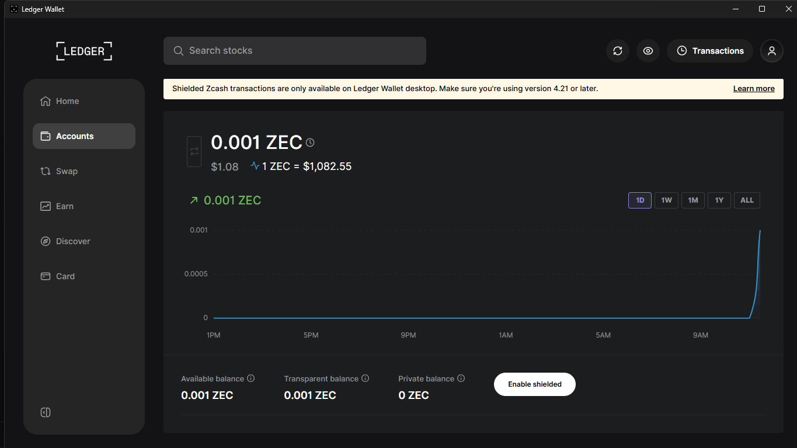
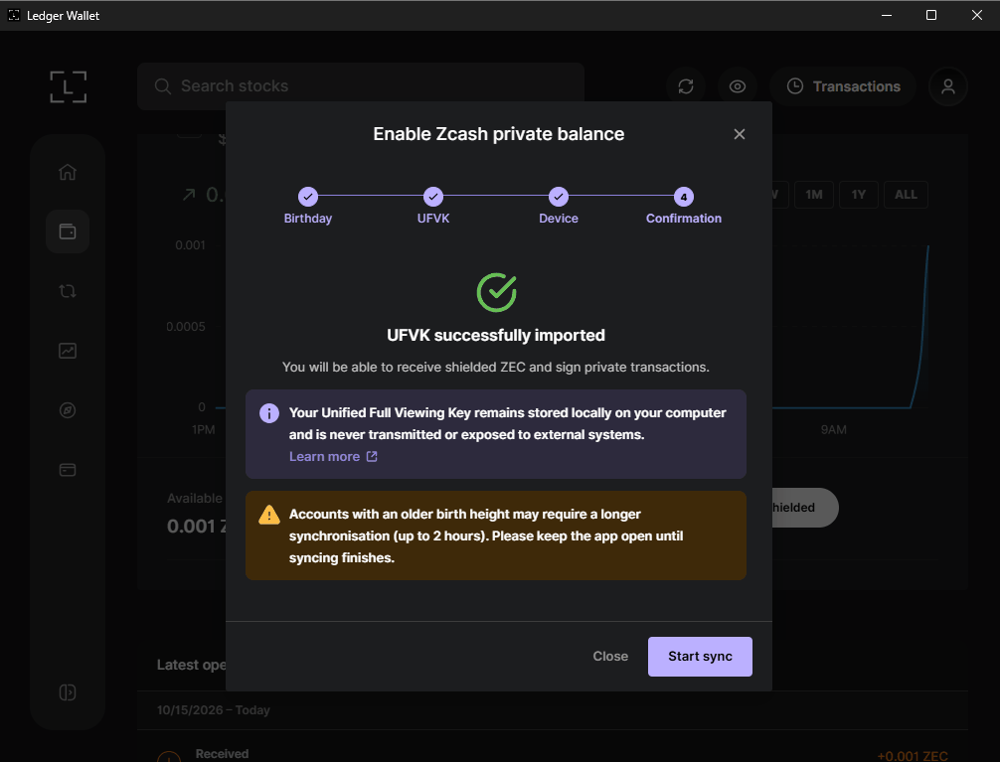
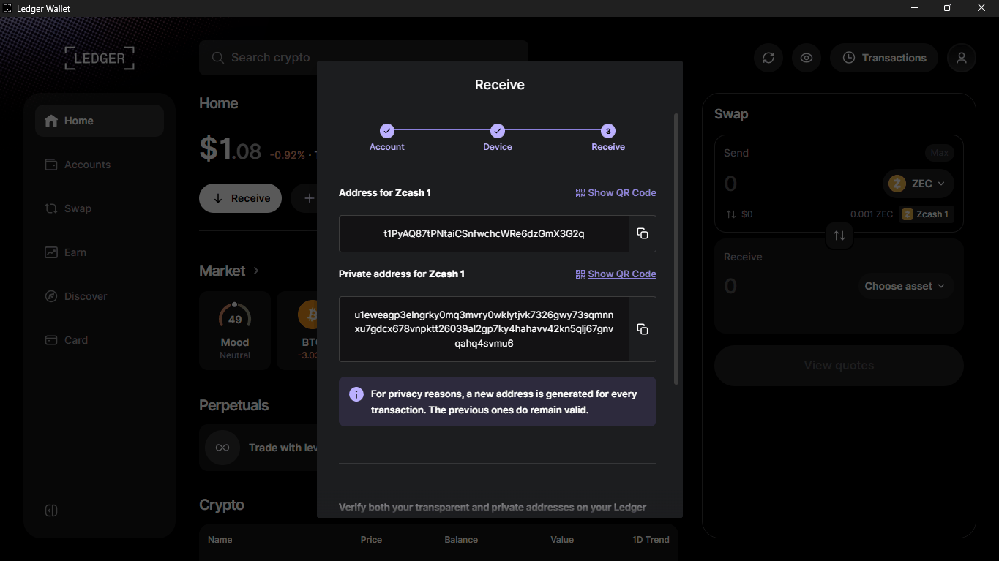
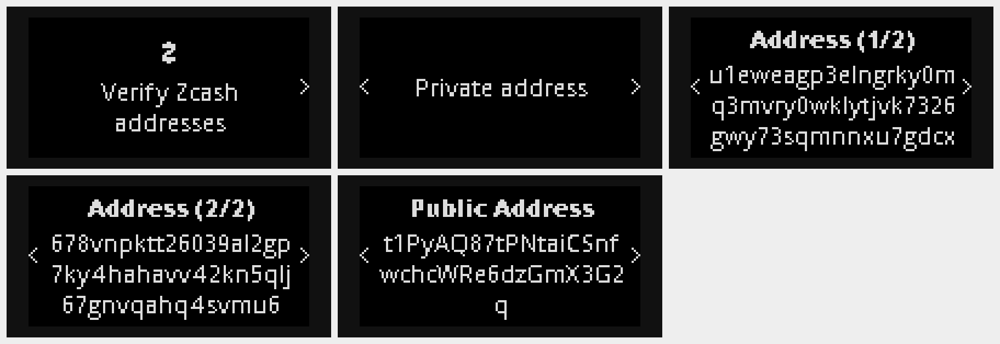
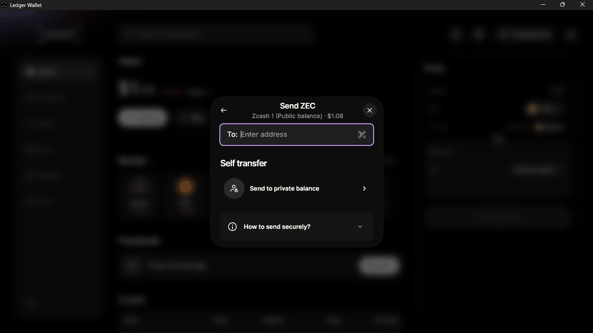
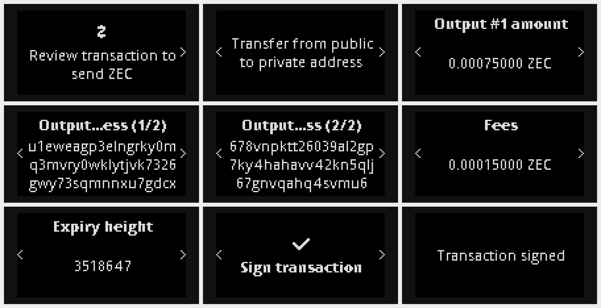
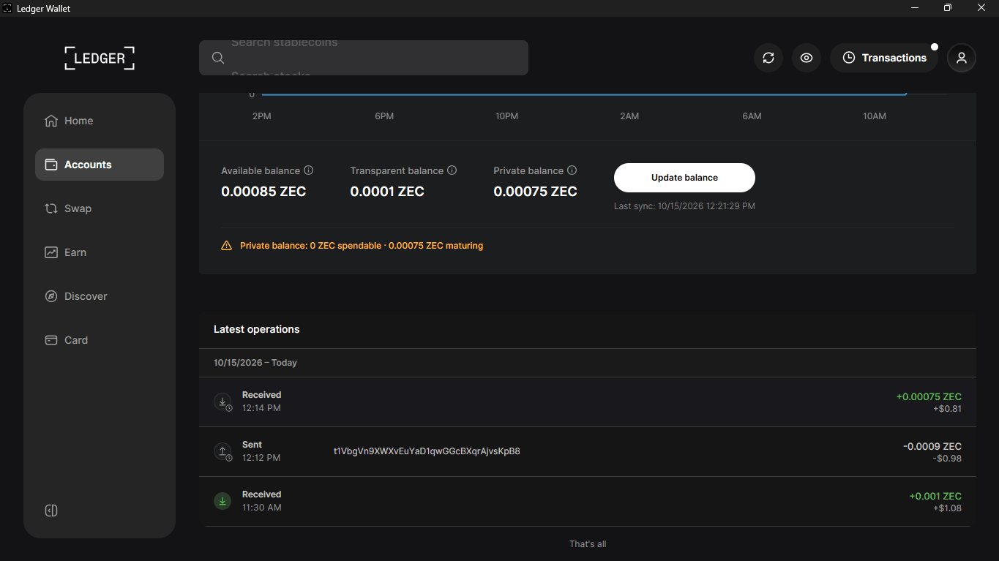
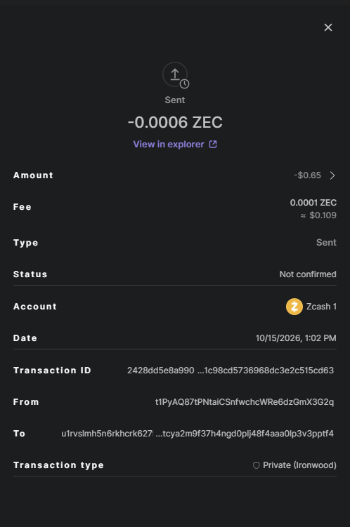

# Ledger 거래정보 보호 ZEC 사용자 가이드

> Ledger Wallet Desktop에서 Ledger 하드웨어 지갑으로 비공개(거래정보 보호) ZEC를 보관하고, 받고, 보내세요.

## 요약

* 2026년 9월 23일부터 Ledger Wallet Desktop에서 거래정보 보호 ZEC를 지원합니다. Zcash 계정 하나에 투명 잔액과 Ironwood 거래정보 보호 구역의 비공개 잔액이 있습니다.
* 현재는 데스크톱에서만 사용할 수 있습니다. 모바일 지원은 “곧 제공될 예정”이라고 안내되어 있습니다.
* Nano S Plus, Nano X, Stax 또는 Flex(기존 Nano S 제외), Ledger Wallet Desktop 4.21 이상, 최신 Zcash 앱이 필요합니다.
* **거래정보 보호 활성화**를 한 번 클릭하면 Ledger에서 viewing key를 내보내 데스크톱 앱이 비공개 자금을 찾을 수 있습니다. spending key는 기기 밖으로 나가지 않습니다.
* 가능하면 비공개 주소(u1...)로 받으세요. 투명 잔액에서 비공개 잔액으로 ZEC를 옮길 수도 있지만, 이 경우 두 잔액의 연결 관계가 드러납니다.
* 보낼 때마다 Ledger 화면에서 내용을 검토하고 서명합니다. 해당 화면에서 주소의 각 문자를 하나씩 확인하세요.

## 핵심 설명

Zcash에는 두 종류의 잔액이 있습니다. 투명 ZEC(t1 주소)는 Bitcoin과 마찬가지로 금액과 주소가 공개됩니다. 거래정보 보호 ZEC는 거래정보 보호 구역에 보관되며, 송신자와 수신자, 금액이 온체인에서 암호화됩니다.

Ledger는 spending key를 하드웨어 기기에 보관합니다. 비공개 잔액을 표시하려면 Ledger Wallet Desktop에 통합 Full Viewing Key(UFVK)가 필요합니다. 기기에서 UFVK를 한 번 내보내면 데스크톱 앱이 이를 사용해 블록체인을 검색하고 거래정보 보호 노트를 찾습니다. viewing key로 거래정보 보호 거래 내역을 볼 수는 있지만 자금을 사용할 수는 없으므로, 비공개 정보로 취급하세요.

아래 단계에서는 Zcash 앱 설치, 계정 추가, 비공개 잔액 활성화, 받기, 투명 ZEC를 거래정보 보호로 전환하기, 비공개 잔액에서 보내기를 설명합니다.

## 개요

2026년 9월 23일, Ledger에서 Ledger Wallet Desktop에 거래정보 보호 ZEC 기능을 기본으로 추가했습니다. 이제 Zcash 계정 하나에 투명 잔액과 Zcash의 Ironwood 거래정보 보호 구역에 있는 비공개 잔액이 보관됩니다. 비공개 키는 Ledger에 보관되며, 모든 거래는 기기에서 검토하고 서명합니다.

**데스크톱에서만 사용 가능.** Ledger의 안내에 따르면 거래정보 보호 ZEC는 “Ledger Wallet Desktop에서만 사용할 수 있습니다. 현재 모바일 지원은 제공되지 않지만, 곧 제공될 예정입니다.” 데스크톱 앱에도 같은 안내가 표시됩니다. 2026년 10월 15일 확인.

## 준비 사항

- Zcash 앱을 실행할 수 있는 Ledger 기기: Nano S Plus, Nano X, Stax 또는 Flex. 현재 Zcash 앱은 기존 Nano S용으로 제작되지 않았습니다.
- Ledger Wallet Desktop 4.21 이상. [ledger.com](https://www.ledger.com)에서만 다운로드하세요. 이 가이드에서는 버전 4.24.0을 사용했습니다.
- Ledger에 설치된 최신 Zcash 앱(이 가이드 작성 당시 버전 3.9.4).
- 테스트에 사용할 소량의 ZEC. 아래 단계는 모두 메인넷에서 0.001 ZEC로 진행했습니다. 각 거래에는 소액의 네트워크 수수료가 듭니다(테스트에서는 0.00015 ZEC).
- 24단어 복구 문구는 종이에 보관하세요. 컴퓨터에 입력하거나 다른 사람과 공유하지 마세요.

## 단계별 가이드(Ledger Wallet Desktop)

**1. Zcash 앱 설치 또는 업데이트**
- Ledger Wallet을 열고 Ledger를 연결해 잠금 해제한 다음 **내 Ledger**를 여세요. 기기에서 연결을 허용하세요.
- 앱 카탈로그에서 **Zcash**을 검색한 다음 **설치**를 클릭하세요. 이미 설치되어 있다면 **업데이트**를 클릭하세요.
- Ledger에서 Zcash 앱을 여세요. 화면에 “Zcash 앱이 준비되었습니다”라고 표시됩니다. 오른쪽으로 스크롤해 **앱 정보**에서 버전을 확인하세요.

**2. Zcash 계정 추가**
- Ledger Wallet에서 **계정 추가**를 선택하세요. **자산 선택**에서 Zcash를 검색하고 **Zcash(ZEC)**를 선택하세요. Binance-Peg Zcash Token과 같은 래핑된 토큰은 선택하지 마세요.
- Ledger에서 Zcash 앱을 연 상태로 두면 Ledger Wallet에서 계정을 찾습니다. **추가할 계정 선택** 아래에서 해당 계정을 선택하고 **확인**을 클릭하세요.
- 계정 페이지에 **사용 가능 잔액**, **투명 잔액**, **비공개 잔액**과 **거래정보 보호 활성화** 버튼이 표시됩니다.

**3. 비공개 잔액 활성화**
- **거래정보 보호 활성화**를 클릭하세요. **Zcash 비공개 잔액 활성화** 창에는 생일, UFVK, 기기, 확인의 4단계가 표시됩니다.
- **생일:** 새 계정이라면 생일 블록 높이를 오늘 날짜로 유지하세요. “이 계정은 과거에 거래정보 보호 ZEC를 받았습니다”는 해당 사실을 알고 있는 경우에만 선택하세요. 블록 0부터 검색하면 시간이 오래 걸릴 수 있습니다.
- **UFVK 및 기기:** Ledger Wallet에서 Ledger에 통합 Full Viewing Key(UFVK)를 내보내도록 요청합니다. 기기 화면을 읽고 승인하세요. “기기 연결이 끊겼습니다”라는 메시지가 표시되면 Zcash 앱이 열려 있는지 확인하고, 신속히 승인한 다음 **다시 시도**를 클릭하세요.
- **UFVK를 성공적으로 가져왔습니다**가 표시되면 **동기화 시작**을 클릭하세요. 동기화가 완료되면 버튼이 **잔액 업데이트**로 바뀌고 “마지막 동기화” 시간이 표시됩니다.
- viewing key는 컴퓨터에 보관됩니다. 거래정보 보호 자금을 찾을 수는 있지만 사용할 수는 없습니다.

**4. ZEC 받기 및 Ledger에서 두 주소 확인하기**
- **받기**를 클릭하고 Zcash 계정을 선택하세요. Ledger Wallet에 **Zcash 1의 주소**(투명 주소, t1로 시작)와 **Zcash 1의 비공개 주소**(u1로 시작)가 표시됩니다. 이전 주소도 계속 유효합니다.
- Ledger에 “Zcash 주소 확인”이 표시됩니다. 이어서 2페이지에 걸쳐 **비공개 주소**, 그 다음 **공개 주소**가 표시됩니다. 주소를 공유하기 전에 화면의 모든 문자를 대조한 다음 기기에서 확인하세요.
- 비공개 주소를 우선 사용하고, 송신자가 다른 방식을 지원하지 않을 때만 투명 주소를 사용하세요.

**5. 투명 ZEC를 비공개 잔액으로 옮기기**
- **보내기**를 클릭하세요. **자체 전송** 아래에서 **비공개 잔액으로 보내기**를 선택하세요.
- 금액을 입력하거나 25%, 50%, 75% 또는 **최대**를 선택하세요. 네트워크 수수료를 확인한 다음 **검토**를 클릭하세요.
- Ledger에서 다음 화면을 차례대로 확인하세요. “ZEC 전송 거래 검토”, “공개 주소에서 비공개 주소로 전송”, 금액, 2페이지에 걸쳐 표시되는 출력 주소, 수수료, 만료 블록 높이입니다. 출력 주소가 4단계의 비공개 주소와 일치하는지 확인한 다음 **거래 서명** 화면에서 버튼 2개를 모두 누르세요.
- Ledger Wallet에 **거래 전송 완료**가 표시됩니다. 거래 세부 정보의 유형은 **비공개(Ironwood)**로 표시됩니다.
- Ledger Wallet에 따르면 자체 전송은 거래정보 보호 자금을 공개 주소와 연결합니다. 비공개 주소로 바로 받으면 서로 연결되지 않습니다.

- 거래가 확인되면 투명 잔액은 줄고 비공개 잔액은 늘어납니다. 새 거래정보 보호 자금은 사용할 수 있을 만큼 충분한 확인을 받을 때까지 “숙성 중”으로 표시됩니다.

**6. 비공개 잔액에서 ZEC 보내기**
- 비공개 잔액을 사용할 수 있게 되면 **보내기**를 클릭하고 **보내는 잔액**을 **비공개 잔액**으로 설정하세요.
- 수신자 주소를 붙여넣고 금액을 입력하세요. 수신자만 읽을 수 있는 암호화된 **메모(선택 사항)**를 최대 512바이트까지 추가할 수 있습니다.
- Ledger에서 수신자, 금액, 수수료를 확인한 다음 **거래 서명** 화면에서 버튼 2개를 모두 누르세요.

## 알아두면 좋은 점

- Ledger의 거래정보 보호 ZEC는 현재 데스크톱에서만 사용할 수 있습니다(2026년 10월 15일 확인).
- Ledger Wallet의 비공개 잔액은 Ironwood 거래정보 보호 구역을 사용합니다.
- Ledger에 따르면 세무 자문가와 거래 내역에 대한 읽기 전용 접근 권한을 공유할 수 있습니다. viewing key가 있으면 누구나 거래정보 보호 거래 내역을 볼 수 있으므로, 의도한 경우에만 공유하세요.
- 이 가이드의 기기 화면은 Ledger의 Speculos 에뮬레이터(Nano S Plus)에서 Zcash 앱 3.9.4를 실행해 캡처했습니다. Zcash 메인넷에서 Ledger Wallet Desktop 4.24.0에 연결했습니다. 실제 Ledger에서도 같은 앱이 실행되며 화면도 동일하게 표시됩니다.

## 추가 도움말

- [Ledger Wallet의 새로운 기능: 기본 거래정보 보호 Zcash 지원](https://www.ledger.com/blog-native-shielded-zcash-support)(Ledger의 안내)
- [Ledger 도움말 센터](https://support.ledger.com)
- [ZecHub 지갑 페이지](/using-zcash/wallets)
- [거래정보 보호 구역](/using-zcash/shielded-pools) 및 [Viewing Keys](/zcash-tech/viewing-keys)(ZecHub)
- 다른 하드웨어 지갑 옵션: [Keystone Zashi 사용자 가이드](/guides/keystone-zashi)
