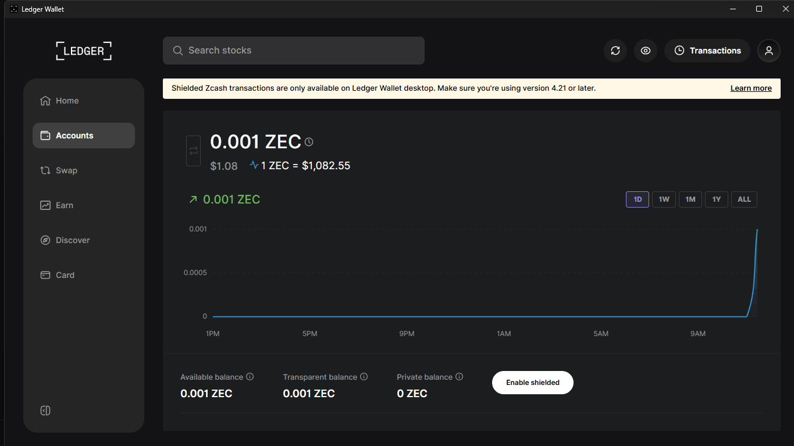
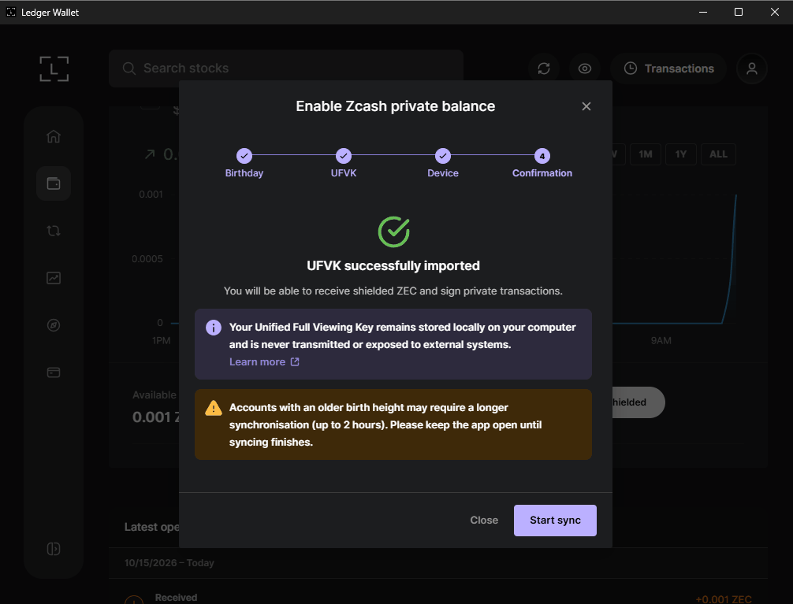
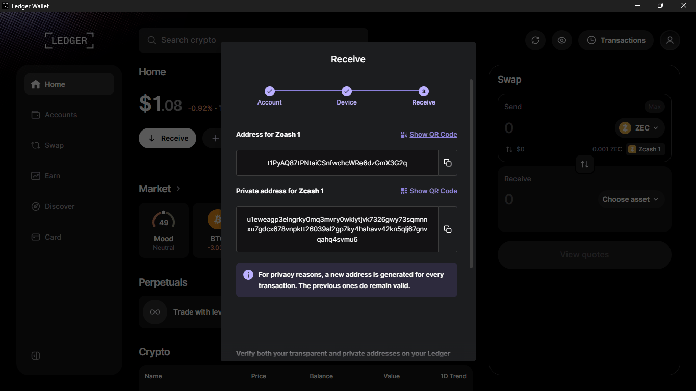
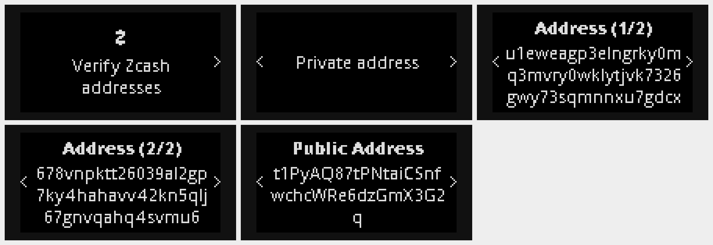
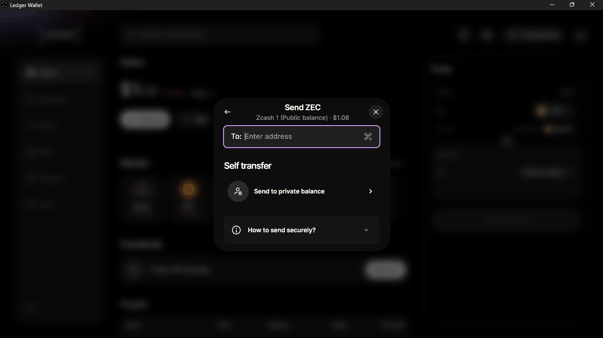
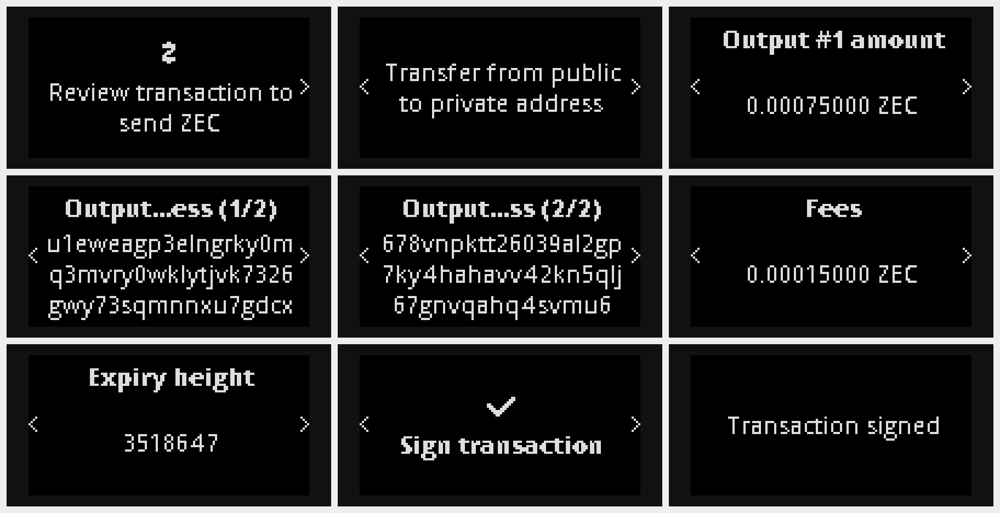
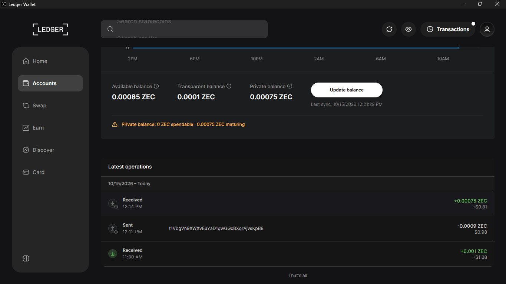
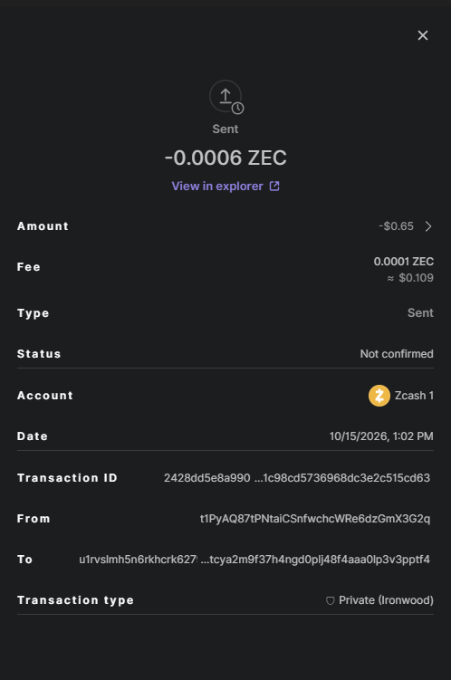

# Guia do usuário de ZEC blindado na Ledger

> Guarde, receba e envie ZEC privado (blindado) com sua carteira de hardware Ledger no Ledger Wallet Desktop.

## Resumo

* Desde 23 de setembro de 2026, o Ledger Wallet Desktop oferece suporte a ZEC blindado. Uma conta Zcash tem um saldo transparente e um saldo privado no pool Ironwood.
* Por enquanto, apenas no desktop. O suporte para celular foi anunciado como "em breve".
* Você precisa de um Nano S Plus, Nano X, Stax ou Flex (não o Nano S original), do Ledger Wallet Desktop 4.21+ e da versão mais recente do app Zcash.
* Clique em **Ativar blindado** uma vez: seu Ledger exporta uma chave de visualização para que o app de desktop encontre seus fundos privados. As chaves de gastos nunca saem do dispositivo.
* Sempre que puder, receba no endereço privado (u1...). Mover ZEC do seu saldo transparente para o privado funciona, mas vincula os dois.
* Cada envio é revisado e assinado na tela do Ledger. Confira os endereços ali, caractere por caractere.

## Explicação principal

O Zcash tem dois tipos de saldo. O ZEC transparente (endereços t1) funciona como o Bitcoin: valores e endereços são públicos. O ZEC blindado fica em um pool blindado, onde o remetente, o destinatário e o valor são criptografados on-chain.

A Ledger mantém suas chaves de gastos no dispositivo de hardware. Para mostrar um saldo privado, o Ledger Wallet Desktop precisa de uma Unified Full Viewing Key (UFVK). O dispositivo a exporta uma vez, e o app de desktop a usa para escanear a blockchain em busca das suas notes blindadas. Uma chave de visualização consegue ver seu histórico blindado, mas não consegue gastar, então trate-a como uma informação privada.

As etapas abaixo cobrem a instalação do app Zcash, a adição de uma conta, a ativação do saldo privado, o recebimento, a blindagem de ZEC transparente e o envio a partir do saldo privado.

## Visão geral

Em 23 de setembro de 2026, a Ledger adicionou suporte nativo a ZEC blindado ao Ledger Wallet Desktop. Uma conta Zcash agora tem um saldo transparente e um saldo privado no pool Ironwood do Zcash. Suas chaves privadas permanecem no seu Ledger, e cada transação é revisada e assinada no dispositivo.

**Apenas no desktop.** O anúncio da Ledger diz que o ZEC blindado está "disponível apenas no Ledger Wallet Desktop. O suporte para celular não está disponível no momento, mas chegará em breve." O app de desktop mostra o mesmo aviso. Verificado em 15 de outubro de 2026.

## Preparação

- Um dispositivo Ledger que execute o app Zcash: Nano S Plus, Nano X, Stax ou Flex. O app Zcash atual não foi desenvolvido para o Nano S original.
- Ledger Wallet Desktop 4.21 ou posterior, baixado apenas de [ledger.com](https://www.ledger.com). Este guia usou a versão 4.24.0.
- A versão mais recente do app Zcash no seu Ledger (3.9.4 quando este guia foi escrito).
- Uma pequena quantidade de ZEC para testar. Todas as etapas abaixo foram feitas na mainnet com 0,001 ZEC. Cada transação custa uma pequena taxa de rede (0,00015 ZEC no nosso teste).
- Sua frase de recuperação de 24 palavras fica no papel. Nunca a digite em um computador nem a compartilhe.

## Guia passo a passo (Ledger Wallet Desktop)

**1. Instale ou atualize o app Zcash**
- Abra o Ledger Wallet, conecte e desbloqueie seu Ledger e abra **Meu Ledger**. Permita a conexão no dispositivo.
- Pesquise **Zcash** no catálogo de apps e clique em **Instalar**, ou em **Atualizar** se ele já estiver instalado.
- Abra o app Zcash no seu Ledger. A tela mostra "O app Zcash está pronto". Role para a direita até **Informações do app** para verificar a versão.

**2. Adicione uma conta Zcash**
- No Ledger Wallet, escolha **Adicionar conta**. Em **Selecionar ativo**, pesquise Zcash e escolha **Zcash (ZEC)**, e não um token encapsulado como Binance-Peg Zcash Token.
- Com o app Zcash aberto no seu Ledger, o Ledger Wallet encontra sua conta. Marque-a em **Selecione as contas que você deseja adicionar** e clique em **Confirmar**.
- A página da conta mostra **Saldo disponível**, **Saldo transparente** e **Saldo privado**, além de um botão **Ativar blindado**.

**3. Ative o saldo privado**
- Clique em **Ativar blindado**. A janela **Ativar saldo privado de Zcash** tem quatro etapas: Aniversário, UFVK, Dispositivo e Confirmação.
- **Aniversário:** para uma conta nova, mantenha a altura de aniversário na data de hoje. Só marque "Esta conta recebeu ZEC blindado no passado" se você souber que recebeu, pois escanear a partir do bloco 0 pode levar muito tempo.
- **UFVK e Dispositivo:** o Ledger Wallet pede ao seu Ledger que exporte sua Unified Full Viewing Key (UFVK). Leia as telas no dispositivo e aprove. Se aparecer "Conexão com o dispositivo perdida", verifique se o app Zcash está aberto, aprove rapidamente e clique em **Tentar novamente**.
- Quando aparecer **UFVK importada com sucesso**, clique em **Iniciar sincronização**. Quando a sincronização terminar, o botão muda para **Atualizar saldo**, com o horário da "Última sincronização".
- A chave de visualização fica no seu computador. Ela consegue encontrar seus fundos blindados, mas não consegue gastá-los.

**4. Receba ZEC e verifique os dois endereços no seu Ledger**
- Clique em **Receber** e escolha sua conta Zcash. O Ledger Wallet mostra um **Endereço para Zcash 1** (transparente, começando com t1) e um **Endereço privado para Zcash 1** (começando com u1). Os endereços anteriores continuam válidos.
- Seu Ledger mostra "Verificar endereços Zcash", o **Endereço privado** em duas páginas e depois o **Endereço público**. Compare cada caractere com a tela antes de compartilhar qualquer um dos endereços e depois confirme no dispositivo.
- Prefira o endereço privado; use o transparente apenas quando o remetente não aceitar nenhum outro.

**5. Mova ZEC transparente para o seu saldo privado**
- Clique em **Enviar**. Em **Autotransferência**, escolha **Enviar para o saldo privado**.
- Digite um valor ou use 25%, 50%, 75% ou **Máx.** Confira a taxa de rede e clique em **Revisar**.
- No seu Ledger, avance pelas telas: "Revise a transação para enviar ZEC", "Transferência de endereço público para privado", o valor, o endereço de saída em duas páginas, a taxa e a altura de expiração. Verifique se o endereço de saída corresponde ao seu endereço privado da etapa 4 e então pressione os dois botões em **Assinar transação**.
- O Ledger Wallet mostra **Transação enviada**. Nos detalhes da transação, o tipo aparece como **Privada (Ironwood)**.
- O Ledger Wallet avisa que uma autotransferência vincula seus fundos blindados ao seu endereço público. Receber diretamente no seu endereço privado os mantém desvinculados.

- Depois que a transação é confirmada, o saldo transparente diminui e o saldo privado aumenta. Os novos fundos blindados aparecem como "em maturação" até terem confirmações suficientes para serem gastos.

**6. Envie ZEC a partir do seu saldo privado**
- Assim que o saldo privado puder ser gasto, clique em **Enviar** e defina **Transferir de** como **Saldo privado**.
- Cole o endereço do destinatário e digite o valor. Você pode adicionar um **Memorando (opcional)** criptografado de até 512 bytes, que só o destinatário consegue ler.
- Revise o destinatário, o valor e a taxa no seu Ledger e então pressione os dois botões em **Assinar transação**.

## Bom saber

- O ZEC blindado na Ledger está disponível apenas no desktop por enquanto (verificado em 15 de outubro de 2026).
- O saldo privado do Ledger Wallet usa o pool Ironwood.
- A Ledger diz que você pode compartilhar acesso somente leitura ao seu histórico de transações com um consultor tributário. Qualquer pessoa com sua chave de visualização pode ver seu histórico blindado, então compartilhe-a apenas de forma intencional.
- As telas do dispositivo neste guia foram capturadas com o emulador Speculos da Ledger (Nano S Plus) executando o app Zcash 3.9.4, conectado ao Ledger Wallet Desktop 4.24.0 na mainnet do Zcash. Um Ledger físico executa o mesmo app e mostra as mesmas telas.

## Ajuda extra

- [Novidade no Ledger Wallet: suporte nativo a Zcash blindado](https://www.ledger.com/blog-native-shielded-zcash-support) (anúncio da Ledger)
- [Central de ajuda da Ledger](https://support.ledger.com)
- [Página de carteiras do ZecHub](/using-zcash/wallets)
- [Pools blindados](/using-zcash/shielded-pools) e [Chaves de visualização](/zcash-tech/viewing-keys) no ZecHub
- Outra opção de carteira de hardware: o [Guia do usuário de Zashi no Keystone](/guides/keystone-zashi)
