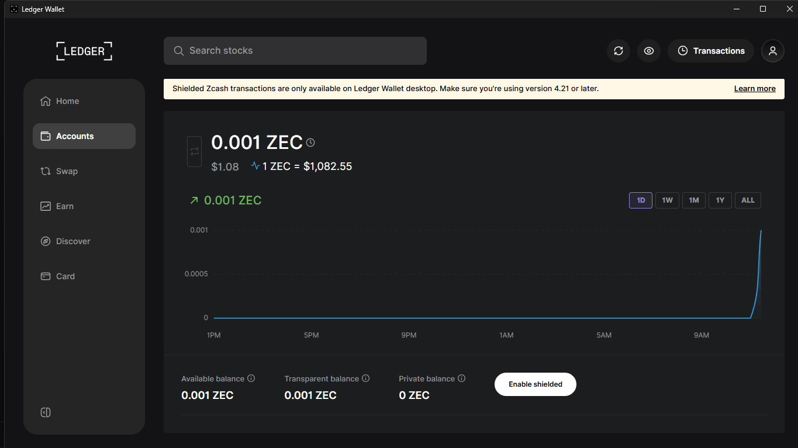
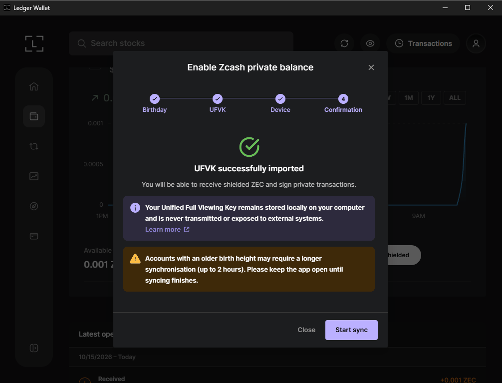
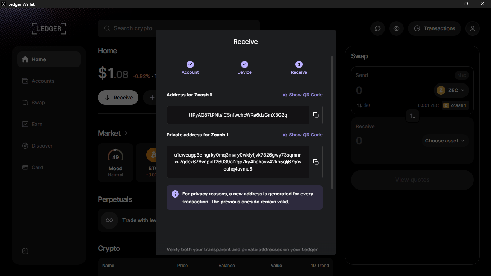
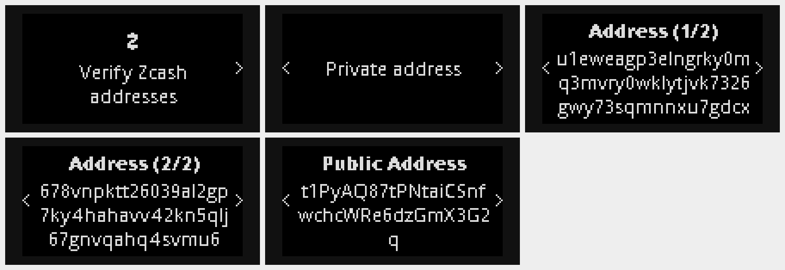
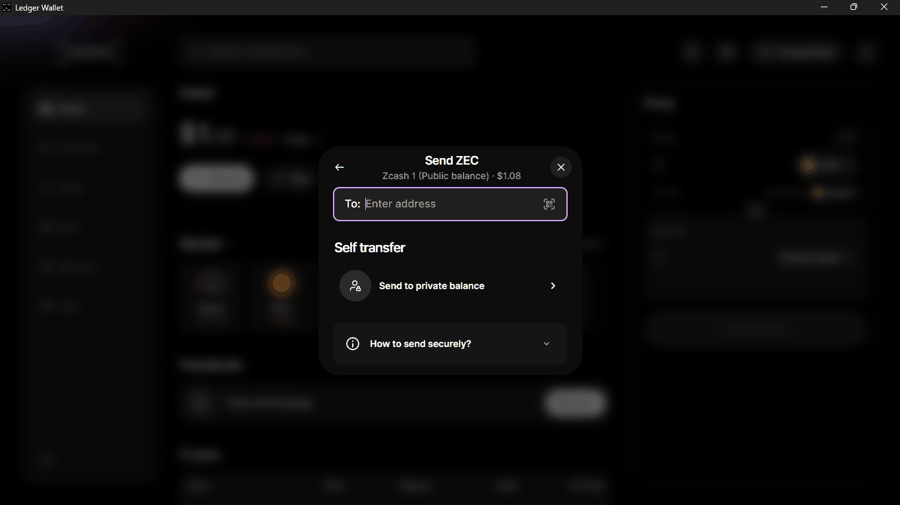
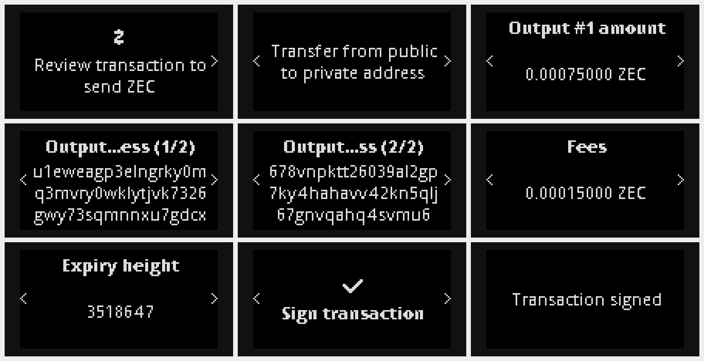
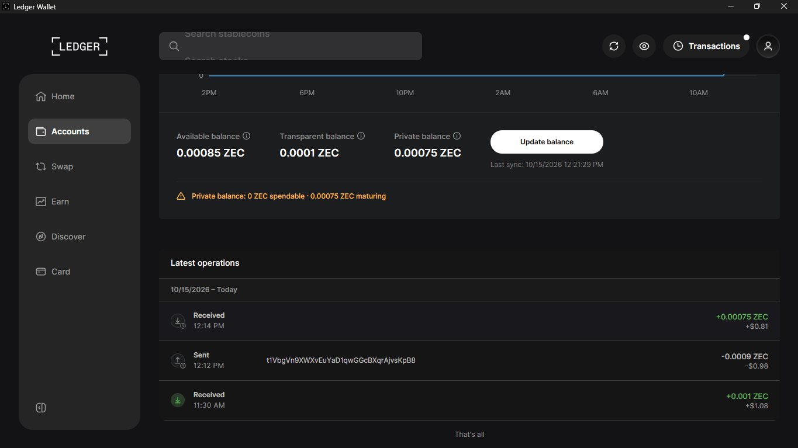
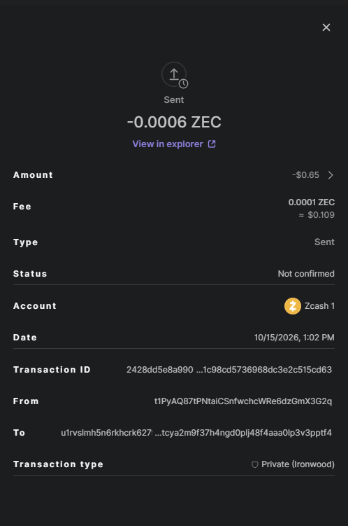

# Ledger Korumalı ZEC Kullanıcı Rehberi

> Ledger Wallet Desktop'ta Ledger donanım cüzdanınızla özel (korumalı) ZEC tutun, alın ve gönderin.

## Özet

* 23 Eylül 2026'dan bu yana Ledger Wallet Desktop, korumalı ZEC desteği sunuyor. Bir Zcash hesabında Ironwood havuzunda şeffaf bakiye ve özel bakiye bulunur.
* Şimdilik yalnızca masaüstünde kullanılabilir. Mobil desteğin “yakında geleceği” duyuruldu.
* Nano S Plus, Nano X, Stax veya Flex (orijinal Nano S değil), Ledger Wallet Desktop 4.21+ ve en son Zcash uygulamasına ihtiyacınız var.
* **Korumalı özelliğini etkinleştir** seçeneğine bir kez tıklayın: Masaüstü uygulamasının özel fonlarınızı bulabilmesi için Ledger görüntüleme anahtarını dışa aktarır. Harcama anahtarları cihazdan asla ayrılmaz.
* Mümkün olduğunda özel adrese (u1...) alın. ZEC tutarlarını şeffaf bakiyenizden özel bakiyeye aktarmak mümkündür, ancak bu ikisini birbirine bağlar.
* Her gönderim, Ledger ekranında incelenir ve imzalanır. Adresleri orada karakter karakter kontrol edin.

## Temel Açıklama

Zcash iki tür bakiyeye sahiptir. Şeffaf ZEC (t1 adresleri) Bitcoin gibi çalışır: Tutarlar ve adresler herkese açıktır. Korumalı ZEC, göndericinin, alıcının ve tutarın zincir üstünde şifrelendiği korumalı bir havuzda yer alır.

Ledger harcama anahtarlarınızı donanım cihazında tutar. Özel bakiyeyi göstermek için Ledger Wallet Desktop'ın Birleşik Full Viewing Key (UFVK) anahtarına ihtiyacı vardır. Cihaz bunu bir kez dışa aktarır ve masaüstü uygulaması blokzinciri korumalı notelarınız için tararken kullanır. Görüntüleme anahtarı korumalı geçmişinizi görebilir ancak harcama yapamaz; bu nedenle özel bilgi olarak değerlendirin.

Aşağıdaki adımlarda Zcash uygulamasının yüklenmesi, hesap eklenmesi, özel bakiyenin etkinleştirilmesi, varlık alınması, şeffaf ZEC'yi korumalı havuza aktarma ve özel bakiyeden gönderim yapılması anlatılır.

## Genel Bakış

23 Eylül 2026'da Ledger, Ledger Wallet Desktop'a yerel korumalı ZEC desteği ekledi. Artık bir Zcash hesabında şeffaf bakiye ve Zcash'ın Ironwood havuzunda özel bakiye bulunuyor. Özel anahtarlarınız Ledger'ınızda kalır ve her işlem cihazda incelenip imzalanır.

**Yalnızca masaüstünde.** Ledger'ın duyurusunda, korumalı ZEC özelliğinin “yalnızca Ledger Wallet Desktop'ta kullanılabildiği belirtiliyor. Mobil destek şu anda mevcut değil, ancak yakında gelecek.” Masaüstü uygulaması da aynı bildirimi gösteriyor. 15 Ekim 2026'da kontrol edilmiştir.

## Hazırlık

- Zcash uygulamasını çalıştıran bir Ledger cihazı: Nano S Plus, Nano X, Stax veya Flex. Mevcut Zcash uygulaması orijinal Nano S için geliştirilmemiştir.
- Yalnızca [ledger.com](https://www.ledger.com) adresinden indirilen Ledger Wallet Desktop 4.21 veya üzeri. Bu rehberde 4.24.0 sürümü kullanılmıştır.
- Ledger cihazınızda en son Zcash uygulaması (bu rehber yazılırken 3.9.4).
- Deneme için az miktarda ZEC. Aşağıdaki her adım ana ağda 0,001 ZEC ile gerçekleştirildi. Her işlem küçük bir ağ ücreti gerektirir (denememizde 0,00015 ZEC).
- 24 kelimelik kurtarma ifadeniz kâğıt üzerinde kalmalıdır. Bunu asla bilgisayara yazmayın veya kimseyle paylaşmayın.

## Adım Adım Rehber (Ledger Wallet Desktop)

**1. Zcash uygulamasını yükleyin veya güncelleyin**
- Ledger Wallet'ı açın, Ledger cihazınızı bağlayıp kilidini açın ve **My Ledger** bölümünü açın. Cihazda bağlantıya izin verin.
- Uygulama kataloğunda **Zcash** aratın, ardından yüklü değilse **Install**'a, zaten yüklüyse **Update**'e tıklayın.
- Ledger cihazınızda Zcash uygulamasını açın. Ekranda “Zcash uygulaması hazır” yazar. Sürümü kontrol etmek için **App info** seçeneğine ilerleyin.

**2. Bir Zcash hesabı ekleyin**
- Ledger Wallet'ta **Add account**'ı seçin. **Select asset** bölümünde Zcash aratın ve sarılmış bir token olan Binance-Peg Zcash Token yerine **Zcash (ZEC)** seçin.
- Ledger cihazınızda Zcash uygulaması açıkken Ledger Wallet hesabınızı bulur. **Select the accounts you want to add** altında hesabı işaretleyip **Confirm**'e tıklayın.
- Hesap sayfasında **Available balance**, **Transparent balance** ve **Private balance** ile **Enable shielded** düğmesi görünür.

**3. Özel bakiyeyi etkinleştirin**
- **Enable shielded**'a tıklayın. **Enable Zcash private balance** penceresinde dört adım bulunur: Birthday, UFVK, Device ve Confirmation.
- **Birthday:** Yeni bir hesap için doğum bloğu yüksekliğini bugünün tarihine ayarlı bırakın. “Bu hesap geçmişte korumalı ZEC aldı” seçeneğini yalnızca aldığını biliyorsanız işaretleyin; çünkü 0. bloktan tarama uzun sürebilir.
- **UFVK ve Device:** Ledger Wallet, Birleşik Full Viewing Key (UFVK) anahtarınızı dışa aktarması için Ledger cihazınızdan izin ister. Cihazdaki ekranları okuyup onaylayın. “Device connection lost” görürseniz Zcash uygulamasının açık olduğundan emin olun, isteği hemen onaylayın ve **Retry**'a tıklayın.
- **UFVK successfully imported** mesajını gördüğünüzde **Start sync**'e tıklayın. Eşitleme tamamlanınca düğme, “Last sync” zamanıyla birlikte **Update balance** olarak değişir.
- Görüntüleme anahtarı bilgisayarınızda kalır. Korumalı fonlarınızı bulabilir ancak harcayamaz.

**4. ZEC alın ve her iki adresi Ledger cihazınızda doğrulayın**
- **Receive**'e tıklayın ve Zcash hesabınızı seçin. Ledger Wallet bir **Address for Zcash 1** (şeffaf, t1 ile başlayan) ve bir **Private address for Zcash 1** (u1 ile başlayan) gösterir. Önceki adresler geçerliliğini korur.
- Ledger cihazınızda “Zcash adreslerini doğrulayın” mesajı, iki sayfada **Private address**, ardından **Public Address** görünür. Herhangi bir adresi paylaşmadan önce ekrandaki her karakteri karşılaştırın, sonra cihazda onaylayın.
- Özel adresi tercih edin; şeffaf adresi yalnızca gönderen başka hiçbir seçeneği desteklemiyorsa kullanın.

**5. Şeffaf ZEC varlıklarını özel bakiyenize aktarın**
- **Send**'e tıklayın. **Self transfer** altında **Send to private balance**'ı seçin.
- Bir tutar girin veya %25, %50, %75 ya da **Max** seçeneğini kullanın. Ağ ücretini kontrol edip **Review**'a tıklayın.
- Ledger cihazınızda şu adımları sırayla inceleyin: “ZEC göndermek için işlemi gözden geçirin”, “Genel adresten özel adrese aktarım”, tutar, iki sayfada çıktı adresi, ücret ve sona erme blok yüksekliği. Çıktı adresinin 4. adımdaki özel adresinizle eşleştiğini kontrol edin, ardından **Sign transaction** üzerindeki iki düğmeye de basın.
- Ledger Wallet, **Transaction sent** mesajını gösterir. İşlem ayrıntılarında tür **Private (Ironwood)** olarak görünür.
- Ledger Wallet, kendi aranızda yaptığınız bir aktarımın korumalı fonlarınızı genel adresinize bağladığını belirtir. Doğrudan özel adresinize varlık almak, bunların bağlantısız kalmasını sağlar.

- İşlem onaylandıktan sonra şeffaf bakiye azalır, özel bakiye artar. Yeni korumalı fonlar, harcanmaları için yeterli sayıda onay alana kadar “olgunlaşıyor” olarak görünür.

**6. Özel bakiyenizden ZEC gönderin**
- Özel bakiye harcanabilir olduğunda **Send**'e tıklayın ve **Transfer from** alanını **Private balance** olarak ayarlayın.
- Alıcının adresini yapıştırıp tutarı girin. Yalnızca alıcının okuyabileceği, en fazla 512 baytlık şifrelenmiş bir **Memo (isteğe bağlı)** ekleyebilirsiniz.
- Alıcıyı, tutarı ve ücreti Ledger cihazınızda inceleyin, ardından **Sign transaction** üzerindeki iki düğmeye de basın.

## Bilinmesi Gerekenler

- Ledger üzerindeki korumalı ZEC şimdilik yalnızca masaüstünde kullanılabilir (15 Ekim 2026'da kontrol edilmiştir).
- Ledger Wallet'ın özel bakiyesi Ironwood havuzunu kullanır.
- Ledger, işlem geçmişinize salt okunur erişimi bir vergi danışmanıyla paylaşabileceğinizi belirtiyor. Görüntüleme anahtarınıza sahip olan herkes korumalı geçmişinizi görebilir; bu nedenle anahtarı yalnızca bilinçli olarak paylaşın.
- Bu rehberdeki cihaz ekranları, Zcash uygulaması 3.9.4'ü çalıştıran Ledger Speculos emülatörüyle (Nano S Plus), Zcash ana ağında Ledger Wallet Desktop 4.24.0'a bağlanarak kaydedildi. Fiziksel bir Ledger aynı uygulamayı çalıştırır ve aynı ekranları gösterir.

## Ek Yardım

- [Ledger Wallet'ta yeni: Yerel Korumalı Zcash Desteği](https://www.ledger.com/blog-native-shielded-zcash-support) (Ledger duyurusu)
- [Ledger Yardım Merkezi](https://support.ledger.com)
- [ZecHub Cüzdanlar sayfası](/using-zcash/wallets)
- ZecHub üzerinde [Korumalı Havuzlar](/using-zcash/shielded-pools) ve [Görüntüleme Anahtarları](/zcash-tech/viewing-keys)
- Başka bir donanım cüzdanı seçeneği: [Keystone Zashi Kullanıcı Rehberi](/guides/keystone-zashi)
