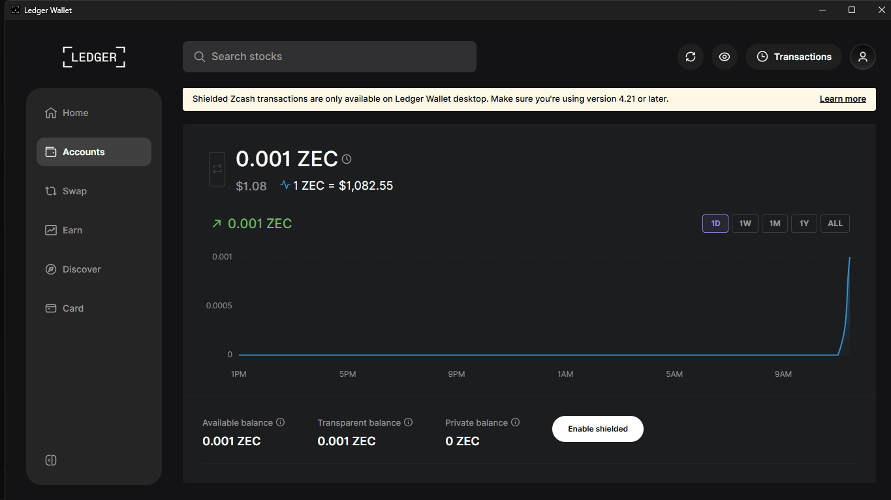
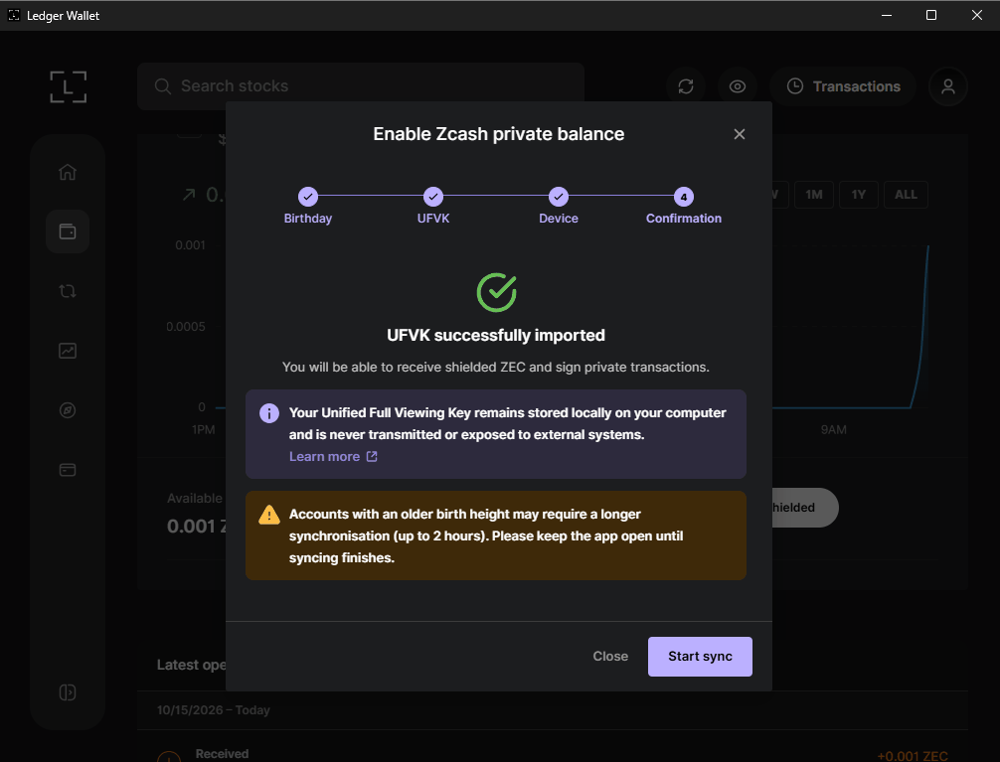
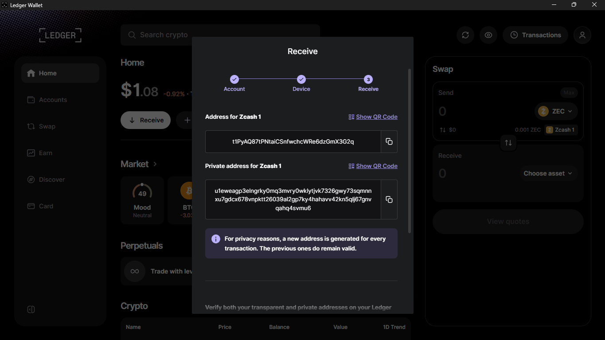
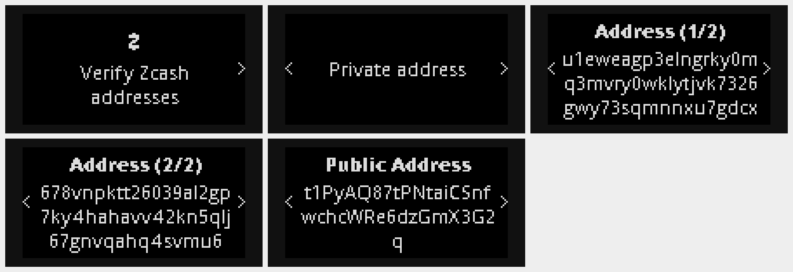
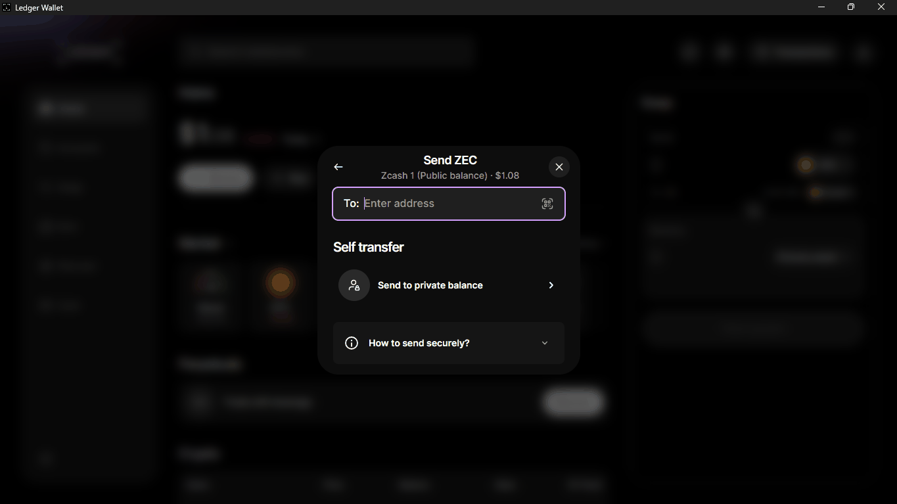
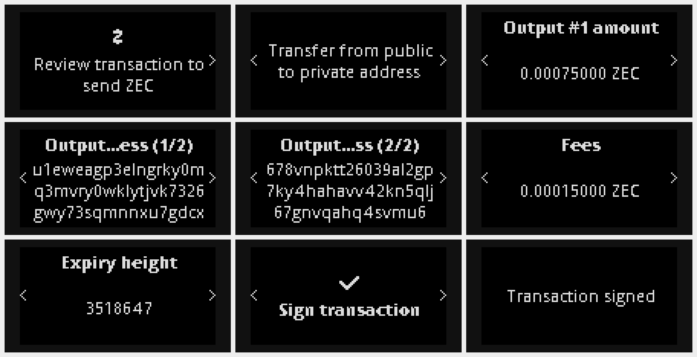
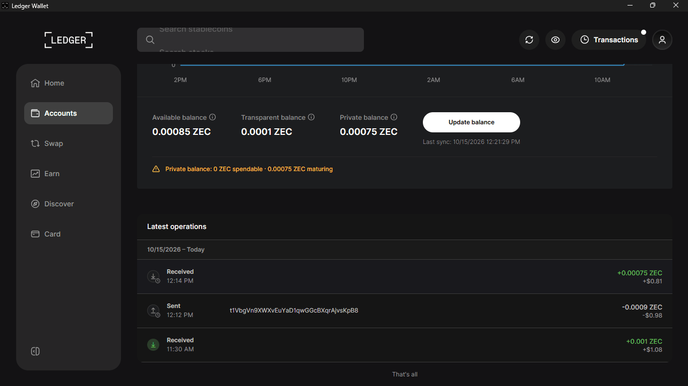
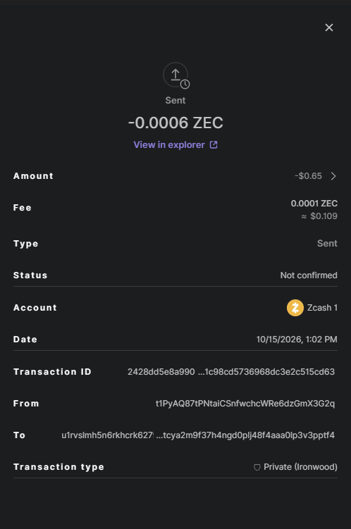

# Itọsọna Olumulo ZEC ti a fi Ledger ṣe aabo

Ní ọjọ́ kẹtàlélógún oṣù kẹsàn-án ọdún 2026, Ledger fi ZEC tí a fi ààbò ìbílẹ̀ ṣe kún Ledger Wallet Desktop. Àkọọ́lẹ̀ Zcash kan báyìí ní ìwọ́ntúnwọ̀nsì tí ó ṣe kedere àti ìwọ́ntúnwọ̀nsì ìkọ̀kọ̀ nínú adágún Ironwood Zcash's. Àwọn kọ́kọ́rọ́ ìkọ̀kọ̀ rẹ dúró lórí Ledger, gbogbo ìṣòwò ni a sì ń ṣe àtúnyẹ̀wò àti ìfọwọ́sowọ́pọ̀ lórí ẹ̀rọ náà.

**Ojú-iṣẹ́ kọ̀ǹpútà nìkan.** Ìkéde Ledger's sọ pé ZEC tí a dáàbò bo “wà lórí Ledger Wallet Desktop nìkan. Àtìlẹ́yìn fóònù kò sí ní àkókò yìí, ṣùgbọ́n ó ń bọ̀ láìpẹ́.” Àpù kọ̀ǹpútà náà fi àkíyèsí kan náà hàn. A ṣàyẹ̀wò rẹ̀ ní ọjọ́ 15 Oṣù Kẹ̀wàá 2026.

## Ìmúrasílẹ̀

- Ẹ̀rọ Ledger tó ń lo àpù Zcash: Nano S Plus, Nano X, Stax tàbí Flex. A kò ṣe àpù Zcash tó wà lọ́wọ́lọ́wọ́ fún Nano S àtilẹ̀wá.
- Àpò ìpamọ́ Ledger Desktop 4.21 tàbí lẹ́yìn náà, tí a gbà láti inú rẹ̀ nìkan [ìwé àkọsílẹ̀.com](https://www.ledger.com). Ìwé ìtọ́sọ́nà yìí lo ẹ̀yà 4.24.0.
- Àpù Zcash tuntun lórí Ledger rẹ (3.9.4 nígbà tí a kọ ìwé ìtọ́ni yìí).
- Iye kekere ti ZEC lati danwo pẹlu. Gbogbo igbesẹ ni isalẹ ni a ṣe lori mainnet pẹlu 0.001 ZEC. Iṣowo kọọkan jẹ idiyele nẹtiwọọki kekere (0.00015 ZEC ninu idanwo wa).
- Gbólóhùn ìgbàpadà ọ̀rọ̀ mẹ́rìnlélógún rẹ dúró lórí ìwé. Má ṣe tẹ̀ ẹ́ sínú kọ̀ǹpútà tàbí pín in.

## Ìtọ́sọ́nà Ìgbésẹ̀-ní-Ìgbésẹ̀ (Ledger Wallet Desktop)

**1. Fi sori ẹrọ tabi ṣe imudojuiwọn ohun elo Zcash**
- Ṣí Àpò Ledger, so mọ́ra kí o sì ṣí Lédì rẹ Ledger, kí o sì ṣí **Lédì Ledger**. Jẹ́ kí ìsopọ̀ náà wà lórí ẹ̀rọ náà.
- Wa **Zcash** ninu katalogi ohun elo naa, lẹhinna tẹ **Fi sori ẹrọ**, tabi **Mu dojuiwọn** ti o ba ti fi sii tẹlẹ.
- Ṣí àpù Zcash lórí Ledger. Ìbòjú náà kà pé "Zcash ti ṣetán". Yí lọ sí ọ̀tún sí **Àlàyé àpù** láti ṣàyẹ̀wò ẹ̀yà náà.

**2. Fi àkọọ́lẹ̀ Zcash kan kún un**
- Nínú Àpò Ìpamọ́ Ledger, yan **Fi àkọọ́lẹ̀ kún**. Nínú **Yan ohun ìní**, wá Zcash kí o sì yan **Zcash (ZEC)**, kìí ṣe àmì ìfọwọ́sowọ́pọ̀ bíi Binance-Peg Zcash Token.
- Pẹ̀lú àpù Zcash tí ó ṣí lórí Ledger, Ledger Wallet rí àkọọ́lẹ̀ rẹ. Fi àmì sí i lábẹ́ **Yan àwọn àkọọ́lẹ̀ tí o fẹ́ fi kún** kí o sì tẹ **Confirm**.
- Ojú ìwé àkọ́ọ́lẹ̀ náà fi **Ìwọ̀n tó wà** hàn, **Ìwọ̀n tó hàn gbangba** àti **Ìwọ̀n tó jẹ́ ti ara ẹni**, pẹ̀lú bọ́tìnì **Enable shield** kan.

**3. Mu iwọntunwọnsi ikọkọ ṣiṣẹ**
- Tẹ **Enabled sealed**. Fèrèsé **Enable Zcash private balance** ní ìgbésẹ̀ mẹ́rin: Ọjọ́ ìbí, UFVK, Ẹ̀rọ àti Ìjẹ́rìísí.
- **Ọjọ́ Ìbí:** Fún àkọọ́lẹ̀ tuntun, pa gíga ọjọ́ ìbí mọ́ ní ọjọ́ òní. Fi àmì sí "Àkọọ́lẹ̀ yìí tí a gbà ní ààbò ZEC nígbà àtijọ́" tí o bá mọ̀ pé ó ti rí bẹ́ẹ̀, nítorí wíwo láti inú block 0 lè gba àkókò gígùn.
- **UFVK àti Ẹ̀rọ:** Àpò ìpamọ́ Ledger ń béèrè lọ́wọ́ Ledger rẹ láti kó Unified Full Viewing Key (UFVK) rẹ jáde. Ka àwọn ìbòjú lórí ẹ̀rọ náà kí o sì fọwọ́ sí i. Tí o bá rí "ìsopọ̀ ẹ̀rọ tí ó sọnù", rí i dájú pé àpù Zcash ṣí sílẹ̀, fọwọ́ sí i kíákíá kí o sì tẹ **Tún gbìyànjú**.
- Tí o bá rí **UFVK tí a kó wọlé dáadáa**, tẹ **Bẹ̀rẹ̀ ìfọwọ́sowọ́pọ̀**. Nígbà tí ìfọwọ́sowọ́pọ̀ bá parí, bọ́tìnì náà yóò yípadà sí **Ìwọ̀ntúnwọ̀nsì** pẹ̀lú àkókò "Ìfọwọ́sowọ́pọ̀ Kẹ́yìn".
- Kọ́kọ́rọ́ ìwo náà dúró lórí kọ̀ǹpútà rẹ. Ó lè rí owó tí o fi pamọ́ ṣùgbọ́n kò le ná wọn.

**4. Gba ZEC kí o sì ṣàyẹ̀wò àwọn àdírẹ́sì méjèèjì lórí Ledger**
- Tẹ **Gba** kí o sì yan àkọọ́lẹ̀ Zcash rẹ. Àpò Ledger fi **Àdírẹ́sì fún Zcash 1** hàn (tí ó ṣe kedere, tí ó bẹ̀rẹ̀ pẹ̀lú t1) àti àdírẹ́sì ìkọ̀kọ̀ fún Zcash 1** (tí ó bẹ̀rẹ̀ pẹ̀lú u1). Àwọn àdírẹ́sì ìṣáájú ṣì wúlò.
- Ledger rẹ fi “Ṣàyẹ̀wò àwọn àdírẹ́sì Zcash ” hàn, **Àdírẹ́sì ìkọ̀kọ̀** lórí ojú ìwé méjì, lẹ́yìn náà **Àdírẹ́sì gbogbogbò**. Fi gbogbo ohun kikọ wé ojú ìbojú kí o tó pín àdírẹ́sì méjèèjì, lẹ́yìn náà jẹ́rìí lórí ẹ̀rọ náà.
- Mo fẹ́ àdírẹ́sì ìkọ̀kọ̀ náà; lo èyí tí ó hàn gbangba nìkan nígbà tí olùránṣẹ́ náà kò bá ní ohunkóhun láti fi ránṣẹ́.

**5. Gbe ZEC ti o han gbangba sinu iwọntunwọnsi ikọkọ rẹ**
- Tẹ **Firanṣẹ**. Labẹ **Gbigbe ara ẹni**, yan **Firanṣẹ si iwọntunwọnsi ikọkọ**.
- Tẹ iye kan sii tabi lo 25%, 50%, 75% tabi **Post**. Ṣayẹwo owo nẹtiwọọki naa, lẹhinna tẹ **Review**.
- Lórí Ledger, gbé ìgbésẹ̀ wọ̀nyí: "Ṣe àtúnyẹ̀wò ìṣòwò láti fi ZEC", "Gbé láti àdírẹ́sì gbogbogbò sí àdáni", iye owó náà, àdírẹ́sì ìjáde ní ojú ìwé méjì, owó náà àti gígùn ìparí rẹ̀. Ṣàyẹ̀wò pé àdírẹ́sì ìjáde náà bá àdírẹ́sì ìkọ̀kọ̀ rẹ mu láti ìgbésẹ̀ 4, lẹ́yìn náà tẹ àwọn bọ́tìnì méjèèjì lórí **Wọlé ìṣòwò**.
- Àpò ìpamọ́ Ledger fi hàn pé **Ìṣòwò tí a fi ránṣẹ́**. Nínú àwọn àlàyé ìṣòwò náà, irú rẹ̀ ni **Ìkọ̀kọ̀ (Ironwood)**.
- Àpò ìfowópamọ́ Ledger sọ pé ìfowópamọ́ ara-ẹni so owó ààbò rẹ pọ̀ mọ́ àdírẹ́sì gbogbogbò rẹ. Gbígbà sí àdírẹ́sì àdáni rẹ tààrà kò ní jẹ́ kí wọ́n sopọ̀ mọ́ra.

- Lẹ́yìn tí ìṣòwò náà bá ti jẹ́rìí sí i, ìwọ̀n tí ó hàn gbangba yóò dínkù, ìwọ̀n ìkọ̀kọ̀ yóò sì ga sí i. Àwọn owó tuntun tí a dáàbò bò yóò fi hàn pé wọ́n “ń dàgbà” títí tí wọ́n yóò fi ní ìdánilójú tó láti ná.

**6. Fi ZEC ranṣẹ lati inu iṣuna ikọkọ rẹ**
- Nígbà tí ìwọ́n ìyókù àdáni bá ti ṣeé ná, tẹ **Firanṣẹ** kí o sì ṣètò **Gbigbe láti** sí **Ìwọ̀n ìyókù àdáni**.
- Lẹ́ àdírẹ́sì olùgbà náà kí o sì tẹ iye owó náà sí i. O lè fi **Memo (àṣàyàn)** tí ó tó 512 baiti kún un, èyí tí olùgbà nìkan ló lè kà.
- Ṣe àtúnyẹ̀wò olùgbà, iye àti owó tí ó wà lórí Ledger, lẹ́yìn náà tẹ àwọn bọ́tìnì méjèèjì lórí **Wọlé sí ìṣòwò**.

## Ó dára láti mọ̀

- ZEC ti a daabo bo lori Ledger wa lori tabili fun bayi nikan (a ṣe ayẹwo ni ọjọ 15 Oṣu Kẹwa ọdun 2026).
- Ìwọ̀n ìpamọ́ Ledger Wallet lo adágún Ironwood.
- Ledger sọ pé o le pín wíwọlé sí ìtàn ìṣòwò rẹ pẹ̀lú olùdámọ̀ràn owó orí. Ẹnikẹ́ni tó bá ní kọ́kọ́rọ́ ìwòran rẹ le rí ìtàn ààbò rẹ, nítorí náà pín in ní pàtàkí.
- Àwọn ìbòjú ẹ̀rọ inú ìwé ìtọ́ni yìí ni a fi àwòrán Ledger's Speculos emulator (Nano S Plus) tí ó ń lo Zcash app 3.9.4, tí a so mọ́ Ledger Wallet Desktop 4.24.0 lórí Zcash mainnet yà. Ledger kan tí a fi ṣe àpù kan náà ni ó ń ṣiṣẹ́, ó sì ń fi àwọn ìbòjú kan náà hàn.

## Ìrànlọ́wọ́ Àfikún

- [Tuntun ninu Apamọwọ Ledger: Atilẹyin Zcash ti a daabobo Native Shielded](https://www.ledger.com/blog-native-shielded-zcash-support) (Ledger's)
- [Ile-iṣẹ Iranlọwọ Ledger](https://support.ledger.com)
- [Ojú ìwé àwọn àpò owó ZecHub](/using-zcash/wallets)
- [Àwọn Adágún Tí A Dáàbò Bo](/using-zcash/shielded-pools) àti [Àwọn Kọ́kọ́rọ́ Wíwo](/zcash-tech/viewing-keys) lórí ZecHub
- Aṣayan apamọwọ ohun elo miiran: [Keystone Zashi Itọsọna olumulo](/guides/keystone-zashi)
